# Transition Kit - Legacy Data Entry app to the new Data Entry app (aggregate data) { #detk_transition_kit }

<!--
Converted from "Transition Kit for Legacy Data Entry App to New - revised.docx".
Images: images/DETK/. Section ids use the prefix detk_.
Open items carried over from the Word comments:
- Test which layout options (pivot, tabs, collapsible sections, before/after text) work in the Android app and list them.
- Check the "Use a vertical layout for multi-organisation unit forms" option against the Limitations table, which says multi-organisation unit entry was not rebuilt.
- Optional: add screenshots of the bottom bar and the details panel limits.
-->

## Introduction { #detk_introduction }

This transition kit is designed to support DHIS2 users and implementers in moving from the legacy aggregate data entry app to the new data entry app. It provides practical guidance, highlights key differences, and outlines updated workflows to ensure a smooth transition.

The goal is to help users adapt quickly and efficiently to the new interface and functionalities introduced in the latest DHIS2 versions, while maintaining reporting continuity.

## Benefits in brief { #detk_benefits }

1. **One selection bar:** Data set, organisation unit, period and section are chosen from one bar at the top of the screen.
2. **Detailed data element information:** View code, data element ID, category option combo ID, and last updated details.
3. **Configurable forms:** Supports default, section and HTML-based forms.
4. **Offline functionality:** Values are saved on your computer and sync automatically when you reconnect. Validation, history and the audit log need a connection.
5. **Save status for each cell:** Each cell shows if its value is saved, waiting to sync, invalid (not saved), has a comment or is locked. Open **Options** > **Help** to see what each colour means.
6. **Validation side panel:** Interactive side panels with categorized alerts (High / Medium / Low).
7. **Active development:** The new app is still being developed and maintained. The legacy app is not.
8. **Keyboard navigation:** Move between cells with Tab and the arrow keys and open the details panel with ctrl+enter (cmd+enter on Mac).

> **Important**
>
> **Why this matters for implementers:** The new app keeps all selections in one bar, shows validation results next to the form, and is the version that is still being developed. Training and support effort should go to the new app. 
> 
> *As of DHIS2 version 43, the legacy app is no longer supported and can not be accessed in DHIS2.* 

## Feature comparison of the legacy app and the new app { #detk_feature_comparison }

| Feature | Legacy app | New app |
|:--|:----|:----|
| Interface | Data set and period selectors are in a green box on the middle-left side of the screen. Organisation unit (OU) is on the left panel. | OU, data set and period are all selected from a persistent top bar. The top bar stays in place when you scroll down the page. |
| Menus | Individual buttons in the top-right corner (Run validation, Print form, Print blank form) and at the bottom of the data entry page (Complete, Incomplete, Run validation). | Top-right **Options** button with a dropdown menu: Print form with values, Print empty form, and Help. The bottom of the page has buttons to mark the form complete or incomplete and to run validation. |
| Sections/Filters | Displayed in a green box on the mid-left panel after period selection. | Available directly on the top bar after period selection. |
| Data element filter | Each section has its own data element search bar that works only within that section. | In addition to the section filter, a global search bar filters by data element across all sections. |
| Run validation | Buttons at the top-right and lower mid-left side. Opens a popup listing validation errors. | Button at the bottom of the form. Opens an interactive side panel with alerts grouped as high, medium and low. |
| Data element details | Double-click a data cell to open a popup window for comments, follow-up and last updated information. | Select **View details** from the lower-left panel (above Run validation and Mark incomplete) to open a side panel with follow-up, comments, minimum and maximum limits, history and audit log. |
| Organisation unit list | All organisation units are shown, including ones the data set is not assigned to. | Only organisation units assigned to the selected data set are shown. |
| Invalid values | A popup message says the value is invalid. | The cell turns red and the value is not saved. The bottom bar shows how many invalid values were not saved. |
| Additional selections | Shown as extra dropdowns in the selection box. | Shown as extra dropdowns at the end of the top bar, after Period. |

## Feature comparison in detail, with screenshots { #detk_feature_details }

### User interface { #detk_user_interface }

**New app:**

The data set, organisation unit, reporting period, and section are selected from a single top bar. This compact layout brings the selection controls together, making it easier to see and change the current data entry context.

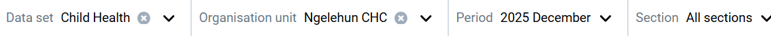

**Legacy app:**

Users select the organisation unit from the hierarchy on the left, then choose the data set and reporting period in the selection panel above the form. The **Filter on section** option allows users to display a specific section.

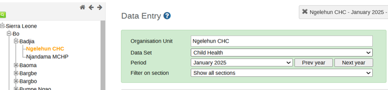

> **Tip**
>
> In the new app, the data set must be chosen before the organisation unit. This order is intentional. It filters the available organisation units to only those assigned to the selected data set.

### Options menu { #detk_options_menu }

**New app:**

- **Print form with values:** Prints the current data entry form including all entered data values. Useful for reviews, audits, or physical record-keeping.
- **Print empty form:** Prints a blank version of the data set form. Useful for offline data collection or field distribution.
- **Help:** Opens a side panel with guidance on the data entry app, including what the colour coding of the cells means and the keyboard shortcuts you can use. See the figure below.

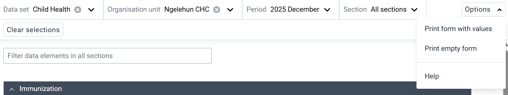

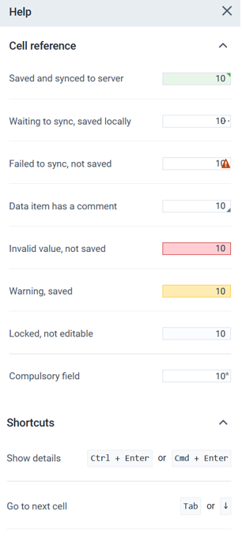{ width=40% }

**Legacy app:** The **Print form** and **Print blank form** buttons are in the top-right corner.

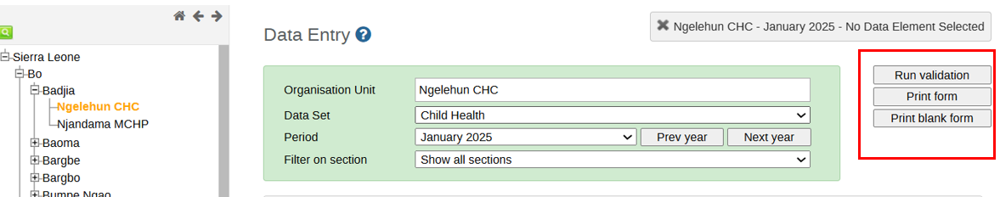

### Sections and filters { #detk_sections_filters }

#### Sections { #detk_sections }

Both apps support section forms, where you can select the section of the form.

**New app:** Sections are displayed on the top bar after the data set, organisation unit and period have been selected.

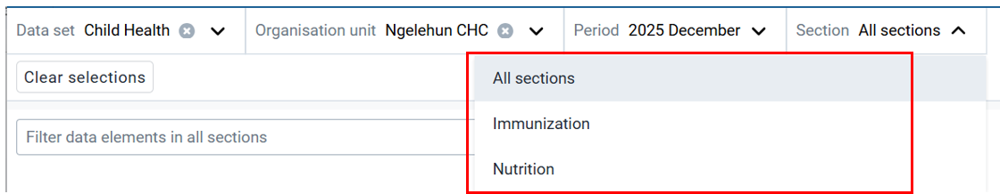

**Legacy app:** The section selector is fixed to the top area after the data set, organisation unit and period have been selected.

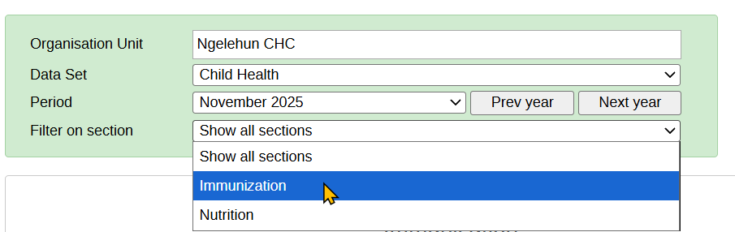

#### Filters { #detk_filters }

**New app:** The filter is global across all sections and can also be applied to one section at a time. You can search for any data element from the top filter bar, and it will display results across the entire form, regardless of which section the element belongs to.

When working within a specific section, the section filter narrows down elements within that section. This helps when navigating large or complex forms.

> **Tip**
>
> Show users how the global filter quickly narrows data elements across the whole form or within a single section. Encourage them to use the filter instead of scrolling to speed up data entry.

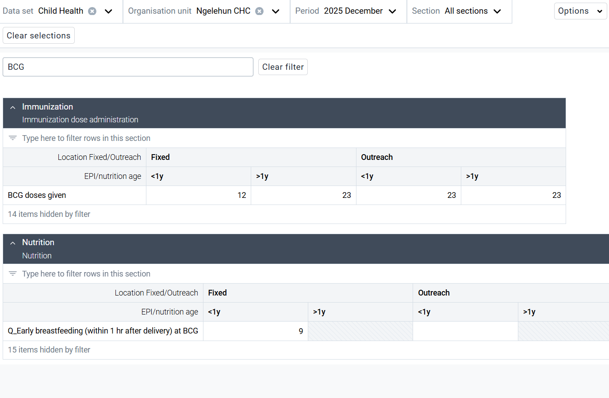

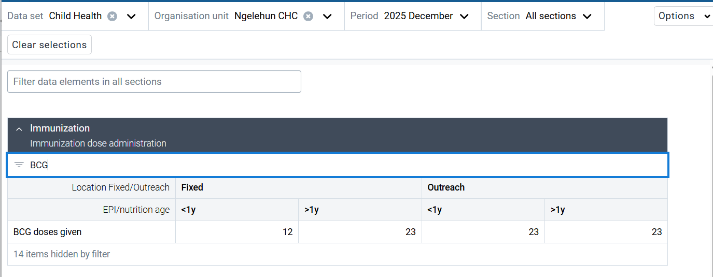

**Legacy app:** The data element filter was limited to one section at a time. To find a data element, you had to first navigate to the section where it was located. 

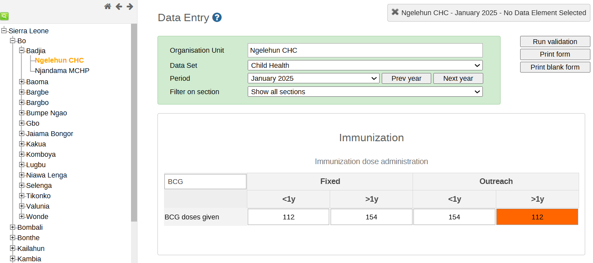

### Run validation { #detk_run_validation }

**New app:** The **Run validation** button is in the bottom-left corner. When selected, validation results appear in a side panel, grouped into High, Medium, and Low, with alerts summarized for easier review. The group comes from the Importance set on each validation rule (High, Medium or Low).

> **Tip**
>
> Show users how the side panel groups validation alerts by severity. Encourage them to review High alerts first and use the panel to move between issues without losing their place in the form.

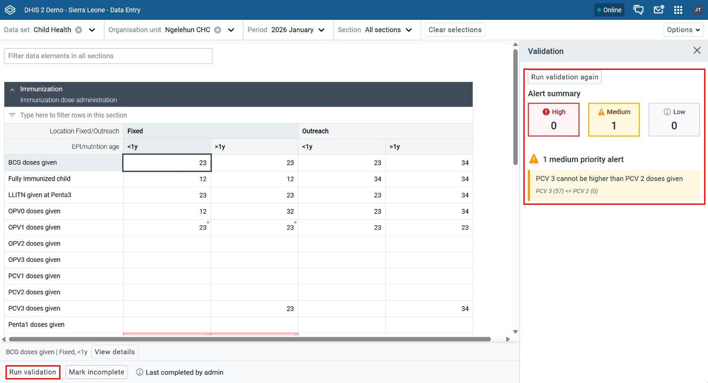

**Legacy app:** The **Run validation** button is in both the top-right menu bar and the bottom of the form. When selected, it opens a window that either shows validation errors or a "Validation Result" message saying the form passed validation.

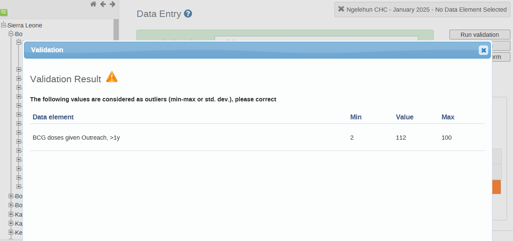

### Data element details { #detk_data_element_details }

**New app:** Selecting a data cell shows the **View details** button in the lower-left section. This opens a side panel where users can mark the value for follow-up, add comments, set minimum and maximum limits (depending on their authority), and see the data element ID, category option combination ID, history and audit log. **Hide details** closes the panel.

> **Tip**
>
> Demonstrate how the View details panel keeps all information for a data item in one place. Show how users can manage data for specific cells from the panel.

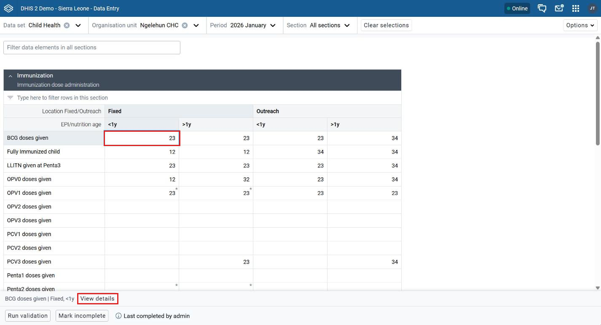

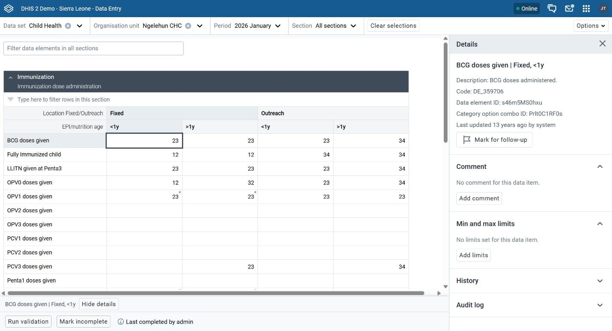

**Legacy app:** When a user double-clicks a data cell, a popup window opens. The popup allowed users to add a comment, mark the value for follow-up, set minimum and maximum limits (depending on their authority), and see the data element history, the audit trail and who last updated the value.

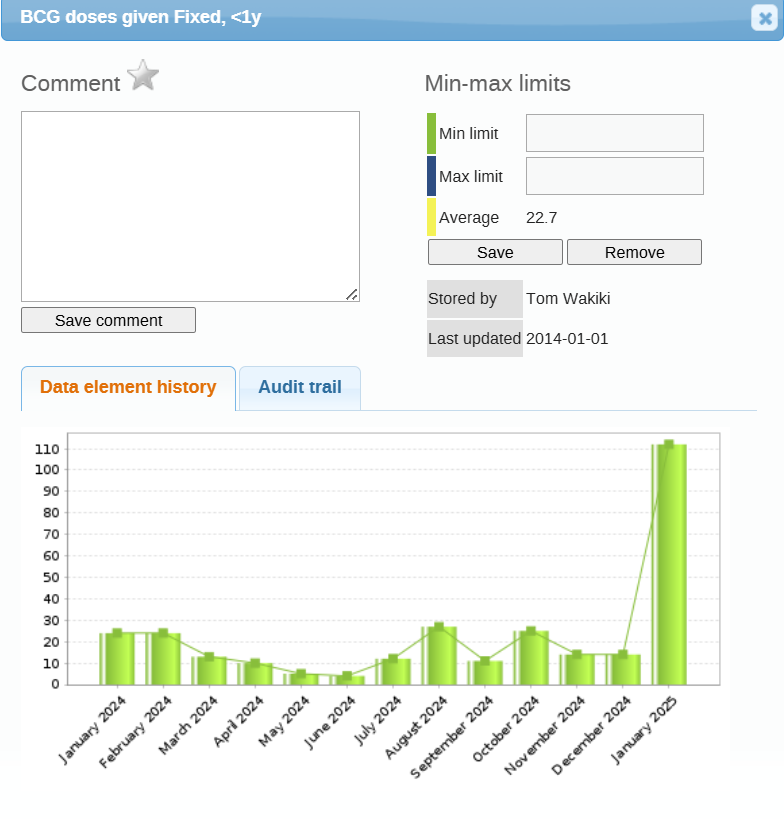{ width=50% }

### Other changes users should know { #detk_other_changes }

- **Keyboard shortcuts:** 
  - tab or arrow-down moves to the next cell
  - shift+tab or arrow-up moves to the previous cell.
  - ctrl+enter (cmd+enter on Mac) opens the details panel.
- **Completing a form:** Use **Mark complete** in the bottom bar when all intended data is entered. Use **Mark incomplete** to reopen it.
- **Minimum and maximum limits:** Set from the details panel. This needs the right user authority, and the limits apply to everyone who uses the data set. *It is recommended you set this system wide in bulk rather then one by one via data entry.*
- **History and audit log:** History shows the last 12 values. The audit log shows who changed a value and when. Both are closed by default and open when you click them.
- **Follow-up:** Values marked for follow-up appear in the Data Quality app.
- **Working offline:** Open the app while online so forms download. Data entered offline syncs when you reconnect. Validation, history and the audit log need a connection.

## New features { #detk_new_features }

The new app introduces new features that make data entry forms easier to use and configure. These updates improve layout flexibility and reduce the need for custom HTML forms.

Implementers can now use built-in options such as configurable section layouts, pivot display settings, vertical tabs, collapsible sections, and custom form titles to create clearer forms.

This matters because custom forms do not work in the DHIS2 Android app. Section forms with these options are the alternative. Test each option in the Android app before relying on it.

> **Tip**
>
> Many layouts that once required custom HTML forms can now be created using built-in options. If users enter data on Android, test each option in the Android app first.

### Collapsible sections { #detk_collapsible_sections }

**New app:** Collapsible sections are built into the data entry layout. They work automatically and do not require any configuration. They help organise long forms and reduce scrolling.

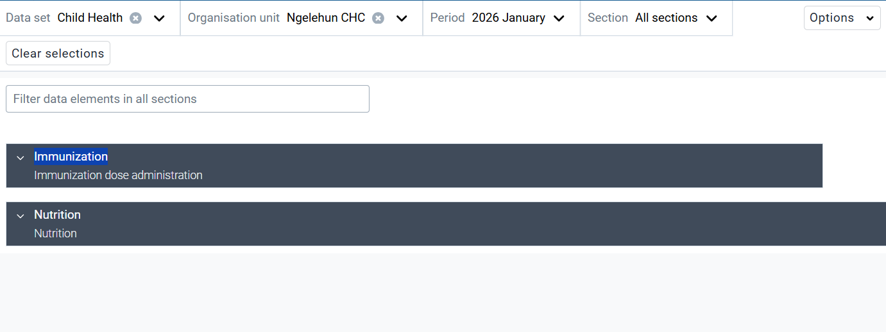

### Vertical tabs { #detk_vertical_tabs }

**New app:** Sections can be shown as tabs, either horizontal or vertical, instead of on one page.

To show sections as tabs:

1. In the Metadata Management app, open the data set.
2. Go to the **Form** section.
3. Under **Display options** > **Section layout**, select **Tabs: Show one tab for each section**.
4. Select **Horizontal tabs** or **Vertical tabs**.
5. Click **Save**.

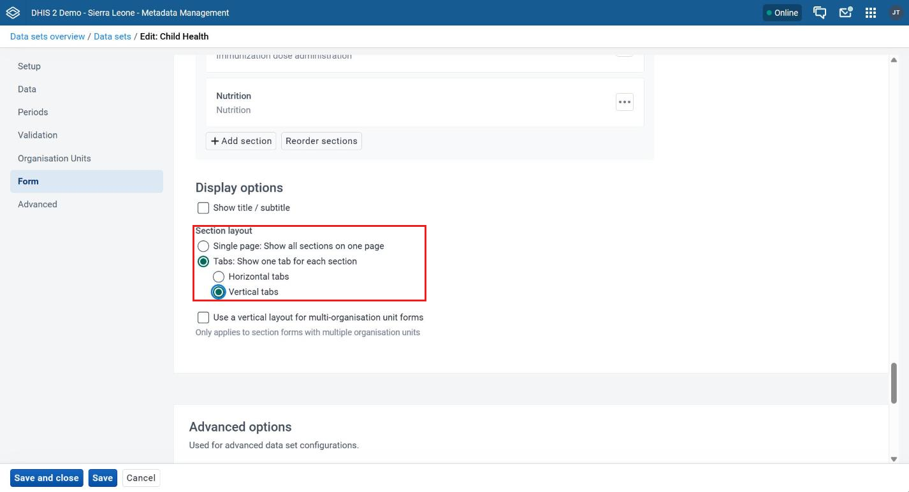

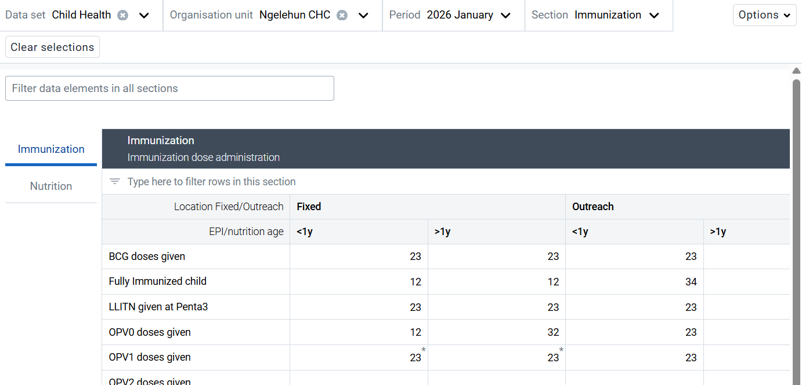

### Pivot display settings for sections { #detk_pivot_display }

This setting lets you choose how data elements and categories are arranged in each section: what appears in rows and what appears in columns.

To configure the pivot options for a section:

1. In the Metadata Management app, open the data set you want to change. It must already have data elements assigned.
2. Go to the **Form** section.
3. Click the options menu (**...**) next to the section you want to change, then click **Edit**.
4. Under **Display options** > **Display mode**, select how you want the section to show.
5. Click **Save section**.

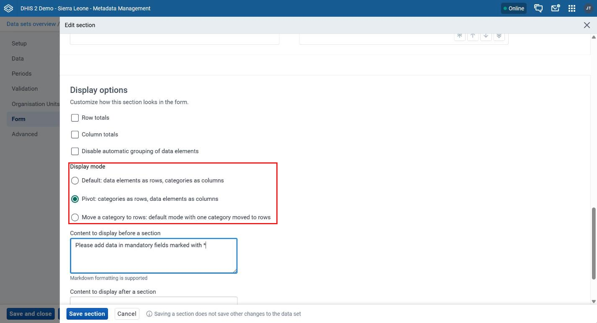

The display modes are:

- **Default:** Data elements as rows and categories (disaggregation dimensions) as columns. This is the default layout.

    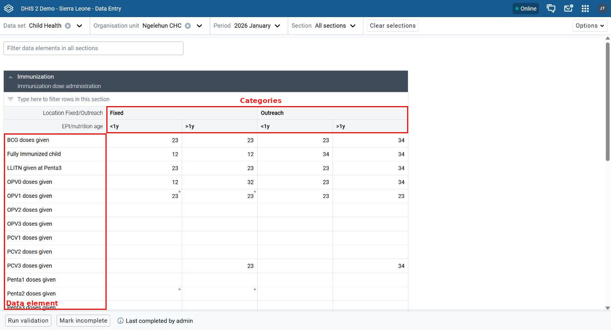

- **Pivot:** Categories as rows, data elements as columns.
    - Useful when there are many data elements and few categories.
    - Makes the form more compact horizontally.

    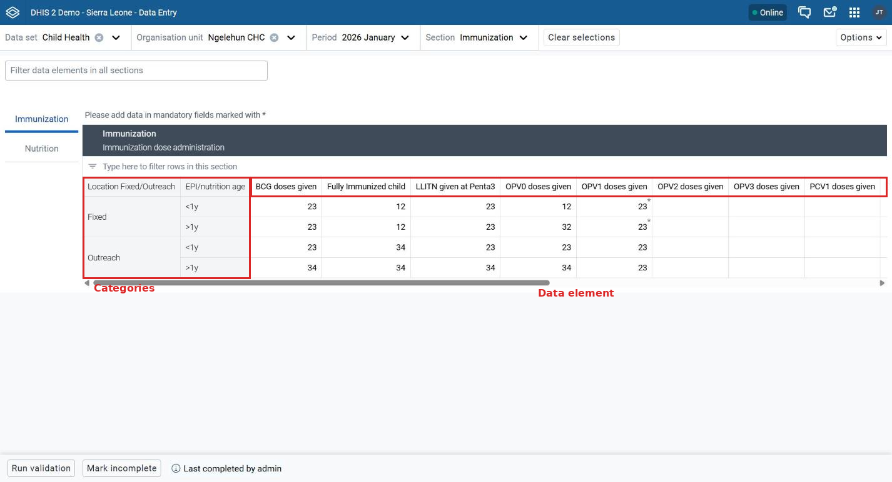

- **Move a category to rows:** A hybrid layout.
    - One category dimension is moved to rows.
    - Gives more control when the data set is large.

    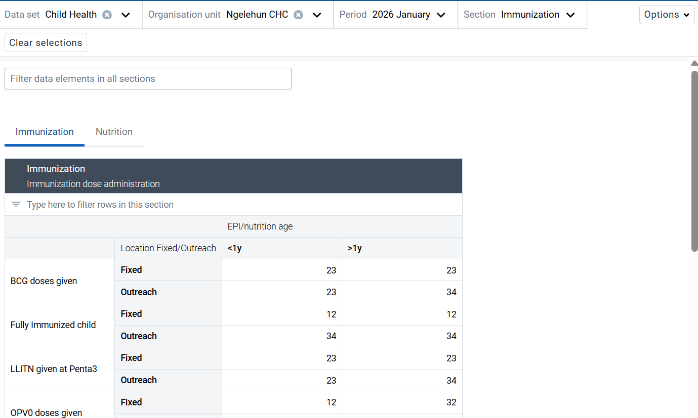

### Content displayed before or after a section { #detk_before_after_section }

You can add instructions, notes, or links that appear above or below a section. Markdown formatted text is supported. Use this to highlight key information and direct users to additional resources.

To add the text, open the section editor as described in [Pivot display settings for sections](#detk_pivot_display). Under **Display options**, fill in **Content to display before a section** or **Content to display after a section**, then click **Save section**. The section editor screenshot above shows these fields.

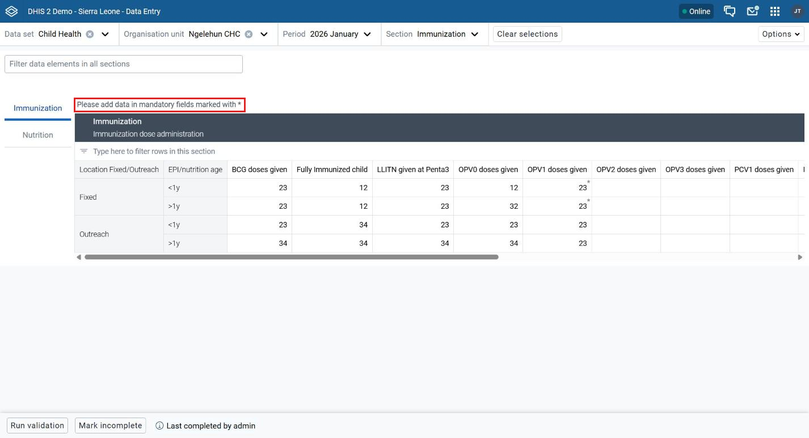

## Switching a data set to the new app { #detk_switching }

Switching a data set from the legacy app to the new app is usually straightforward. Both apps use the same data set and the same data values. Review existing data set configurations, custom forms, validation rules, and workflows before switching.

Some existing configurations may behave differently in the new app, so test each data set before switching.

### Review the current configuration { #detk_review_configuration }

Before switching a data set, review:

- Data elements and category combinations
- Custom or section forms
- JavaScript used in custom forms
- Validation rules
- Indicators
- Existing data entry workflows and reporting requirements

### Understand the changes { #detk_understand_changes }

- **Interface:** Organisation unit, data set and period are selected from the persistent top bar.
- **Custom forms:** HTML-based custom forms are supported. For existing JavaScript-based custom forms, check compatibility with the Custom Forms plugin before switching.
- **Section forms:** Section forms are supported, with additional layout options such as pivot configurations, vertical tabs, and collapsible sections.
- **Filtering:** A global filter is added on top of the section filter.
- **Validation:** Validation results are shown in a side panel next to the form.

### Prepare for migration { #detk_prepare_migration }

- Review the existing data set configuration and identify any custom JavaScript dependencies.
- Decide if existing custom forms can be used with the Custom Forms plugin or should be changed to section forms.
- Review and adjust section layouts where required.
- If possible, use section forms for new or redesigned forms. They are easier to maintain than custom forms.
- Test validation rules, indicators, calculations, and data entry workflows.
- Test the complete data set in the new app before switching users to the new workflow.
- Where applicable, test the data set on both web and Android.

> **Tip**
>
> Encourage implementers to walk through each data set in the new app before switching over. Pay attention to custom forms, JavaScript dependencies, section layouts, validation, and calculations. Testing with real users helps find workflow or usability issues before rollout.

## Limitations of the new app { #detk_limitations }

| Limitation | Consideration |
|:--|:----|
| JavaScript custom forms | The Custom Forms plugin provides JavaScript support in the new app. Existing JavaScript forms should still be reviewed and tested for compatibility. |
| Custom styling | Review existing custom HTML/CSS and confirm that it displays as expected in the new app. |
| Multiple organisation unit entry | This functionality was not rebuilt in the new app. Consider this when assessing data sets that depend on this workflow. |

> **Note**
>
> **Custom forms and JavaScript:** JavaScript support for legacy custom forms is provided through the Custom Forms plugin included with Data Entry app version 102.0.0 and later. To enable support, upgrade the Data Entry app to version 102.0.0 or later in the App Management app. Then test existing custom forms for compatibility.
>
> For more information, see [Support for JavaScript in custom forms](https://docs.dhis2.org/en/use/user-guides/dhis-core-version-master/maintaining-the-system/support-for-javascript-in-custom-forms.html).
