# Transition Kit - Maintenance app to the Metadata Management app { #mmchg_whats_changed }

<!--
DRAFT. Built from the "dhis-core-version-master" user guide pages for both apps and checked on
play.im.dhis2.org/stable-2-43-2 on 14 Oct 2026.
Screenshots: Chrome, 1440x900 viewport, stored in images/MAINT_MM/.
Section ids use the prefix mmchg_ to avoid clashes with the mm_ ids in the Metadata Management app chapter.

Still to verify before publishing:
- PDF data entry form download: confirm it is not available anywhere in the app.
- Bulk Delete: confirm the confirmation step.
- App version used for the check (fill in below).
Still to capture:
- Merge screen (needs a user with merge authorities).
-->

## Who is this transition document for? { #mmchg_audience }

If you configure metadata in DHIS2 and you are used to the Maintenance app, then note that the Metadata Management app replaces it. This page lists what is new, what works differently, and what you still need the Maintenance app for.

- The Metadata Management app is installed from the DHIS2 App Hub.
- It works with DHIS2 version 41 and above.
- It is released continuously. New sections and features arrive often, so update the app from the App Hub before you report something as missing or non-functional.

> **Note**
>
> This page covers the differences between the maintenance app and the metadata management app. For full instructions, see [Configure metadata (Metadata Management app)](#metadata_management_app).

## The Metadata Management app { #mmchg_overview }

The left sidebar lists every metadata object you can manage in this app. The overview page shows a card for each object type, with **Add new** and **Manage** buttons.

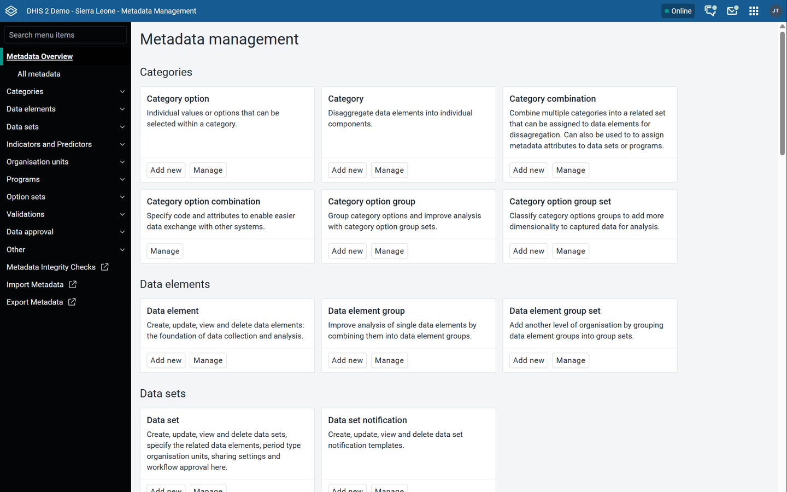

## Summary of changes (when compared to the maintenance app) { #mmchg_summary }

| Function | Maintenance app | Metadata Management app | Status |
|---|---|---|---|
| Create metadata | Plus button, bottom right corner | New bottom in top menu | Changed |
| Edit, clone, delete, translate, sharing settings, show details | Options menu on each object | Options menu (**...**) on each object | Same |
| See who created or last updated an object | Only shows dates in details panel | Shows dates and user in details panel | Changed |
| Choose which columns a list shows | Gear icon at top right of list > **Manage columns** | **Manage View** > **Columns** tab | Changed |
| Choose filters to apply to your current view of the metadata | Not available | **Manage View** > **Filters** tab | New |
| Download metadata from a list | Gear icon at top right of list > **Download** | **Download** button above the list | Changed |
| Search across all metadata types at once | Not available | **All metadata** view | New |
| Change sharing, download or delete many objects at once | Not available | Select objects in the list, then use the bar above the list | New |
| Merge duplicate objects | Not available | Merge screen (needs a merge authority) | New |
| Set compulsory data elements for a data set | Data set options menu > **Edit compulsory data elements** | Data set form > **Validation** section | Changed |
| Add many objects to a group, or one object to many groups | Separate **Edit multiple object groups** screen | Edit from the object or from the group | Changed |
| Download a default data entry form as PDF | Data set options menu > **Get PDF for data entry** | Not in the data set options menu | Not available |
| Push reports (push analysis) | Available | Not available | Use the Maintenance app |
| External map layers | Available | Not available, planned to move to the Maps app | Use the Maintenance app |

## What is new { #mmchg_new }

### All metadata view { #mmchg_all_metadata }

Search for a keyword across many metadata types from one screen.

1. In the sidebar, click **Metadata Overview** > **All metadata**.
2. Type a keyword in the search box. Results are grouped by metadata type, with the number of matches.
3. Use the metadata types dropdown to narrow the results.
4. Expand a type to see the first five matches. Click **Load more** to see more.

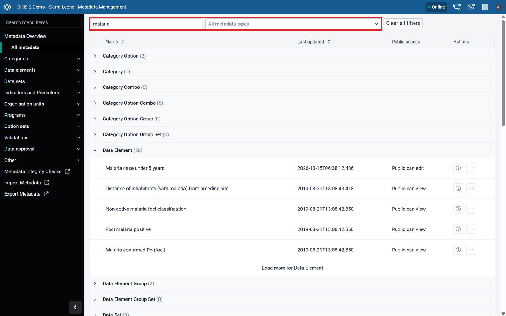

### Bulk actions: sharing, download and delete { #mmchg_bulk_actions }

Select several objects in a list with the checkboxes. A bar appears above the list with **Update sharing**, **Download**, **Delete** and **Deselect all**.

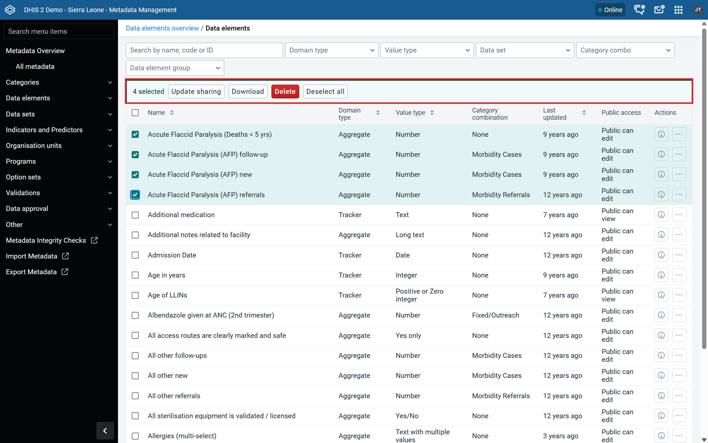

**Update sharing** opens a dialog where you add sharing settings for users, user groups and public access. The changes apply to all selected objects.

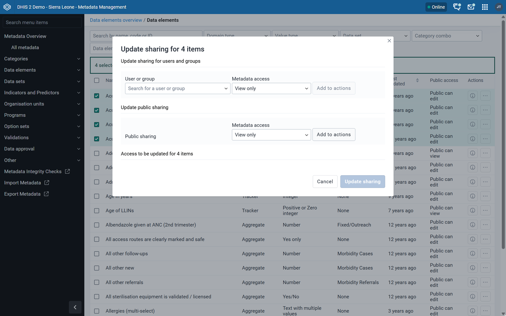

> **Work In Progress**
>
> Editing or removing existing sharing settings in bulk is not yet available.

> **Warning**
>
> **Delete** in the bulk bar deletes all selected objects. Deleting metadata cannot be undone. Metadata dependencies, or metadata that has data associated with it, will still give warnings and/or errors when using this option to delete. 

### Custom filters on each list { #mmchg_list_filters }

Each list has a search bar (name, code or ID) and filters for that object type. For example, data elements can be filtered by domain type, value type, data set, category combination and data element group.

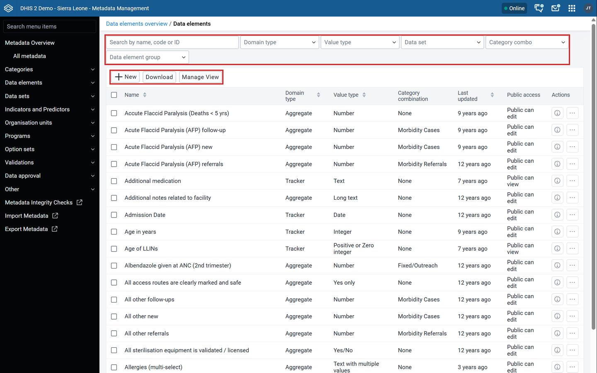

You choose which filters to show with **Manage View** > **Filters**. See [Lists: columns, filters and download](#mmchg_lists).

### Merge duplicate metadata { #mmchg_merge }

Merge combines duplicate objects into one. All references to the source objects move to the target object. The source objects are then deleted.

- The Metadata Management app chapter lists merge for: categories, category combinations, category option combinations, category options, data elements, indicators, indicator types and organisation units.
- Each object type needs its own merge authority. For example, category options need `F_CATEGORY_OPTION_MERGE`. Without it, the merge page shows an error.

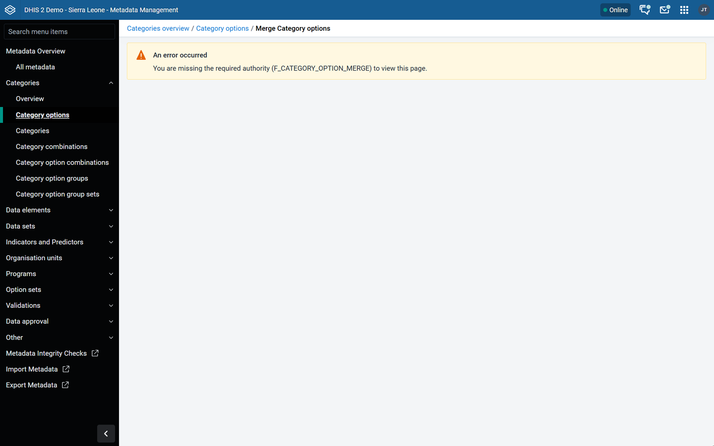

> **Warning**
>
> Merging cannot be undone. Back up your database before you merge.

For the full procedure, see [Merge](#mm_common_actions_merge).

## What works differently { #mmchg_changed }

### Details panel { #mmchg_details_panel }

Click the details icon (**i**) on a row to open the details panel on the right. It shows the code, who created the object, who last updated it, the ID and the API URL. Click **Edit** to open the object.

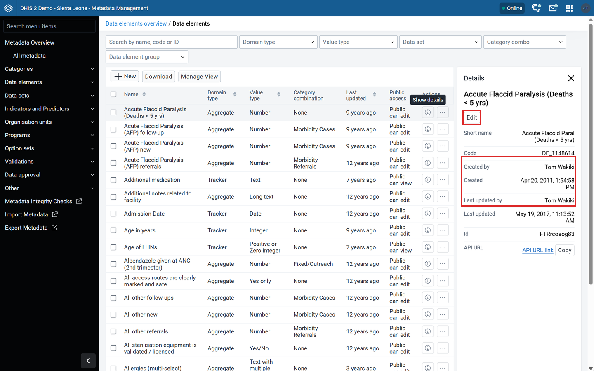

### Options menu { #mmchg_options_menu }

Click the options menu (**...**) on a row for **Edit**, **Clone**, **Show details**, **Sharing settings**, **Translate** and **Delete**.

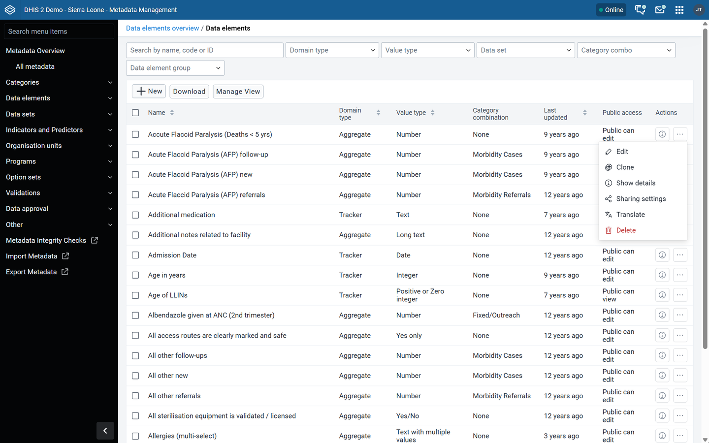

### Lists: columns, filters and download { #mmchg_lists }

Column and filter settings are under the **Manage View** button above the list.

1. Click **Manage View**.
2. Select the **Columns** tab to choose columns, or the **Filters** tab to choose filters.
3. Move items between the available and selected lists with the arrow buttons. Use the up and down arrows to change the order.
4. Click **Update view**. Click **Reset to default** to go back to the default view.

> **Note**
>
> Your choices only change your own view. They do not edit metadata or affect other users.

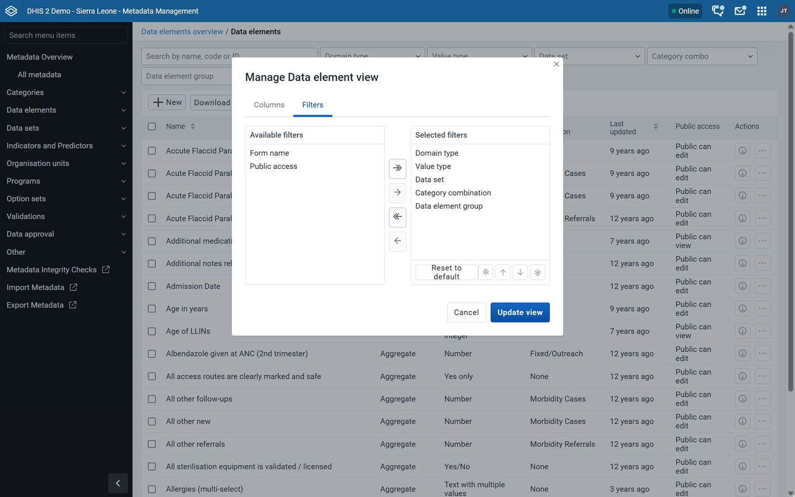

**Download** is a separate button above the list. You choose:

- Compression: Zip, Gzip or Uncompressed
- What to include: all objects, only selected objects, or only objects that match the active filters
- Whether to include user sharing settings

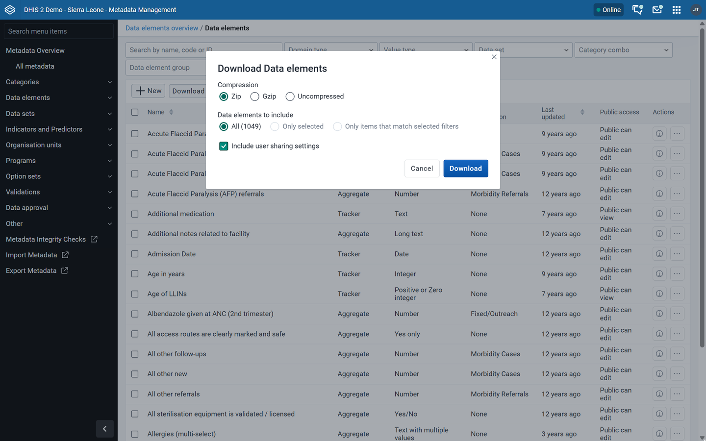

### Assigning items with the transfer list { #mmchg_transfer_list }

Many forms use a two-panel list to assign items, for example data elements to a data element group.

- **Show only unassigned items** hides items that already belong to another group.
- Each panel has its own filter box.
- **Add new** opens a form to create a missing item without leaving the current form. **Refresh list** reloads the available items.

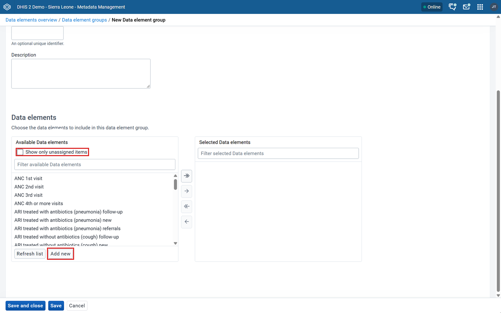

For details, see [Using a transfer list component](#mm_transfer_list_component).

### Group membership { #mmchg_group_membership }

The Maintenance app had a separate screen for editing groups in bulk. The Metadata Management app does not have this screen and it is not planned. Instead:

- One object into many groups: open the object (for example a data element) and assign it to groups.
- Many objects into one group: open the group (for example a data element group) and assign the members.

For details, see [Manage group membership](#mm_edit_multiple_object_groups).

### Data set form { #mmchg_data_set_form }

The data set form is split into sections, listed on the left: **Setup**, **Data**, **Periods**, **Validation**, **Organisation Units**, **Form** and **Advanced**. Click a section name to jump to it.

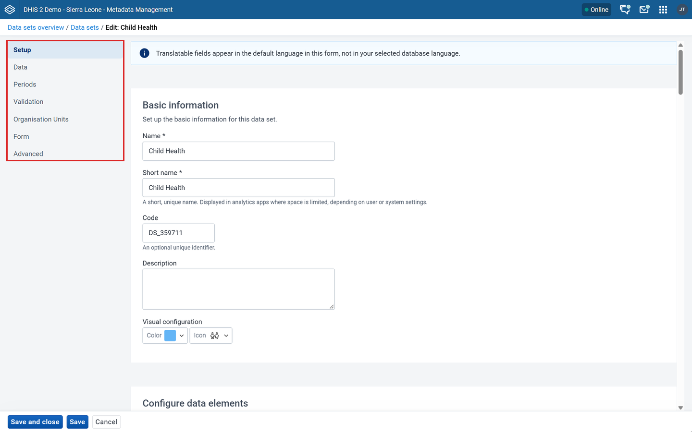

The **Validation** section ("Validation and limitations") has:

- the approval workflow for the data set
- the rules for completing a form, for example "Completing requires passing validation"
- the number of days after the period to qualify for on-time submission
- the compulsory data elements, which used to be a separate action in the options menu

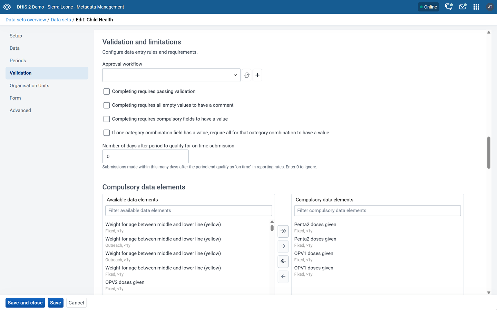

The data set options menu does not have a **Get PDF for data entry** option.

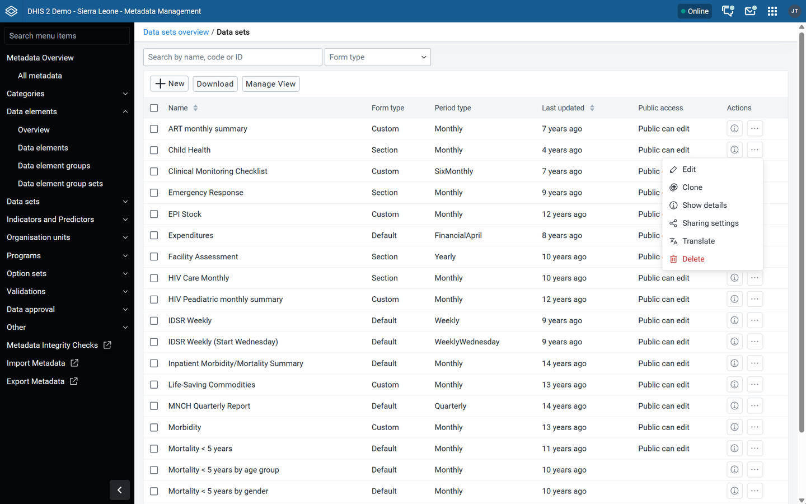

### Organisation units { #mmchg_org_units }

The organisation unit list shows the hierarchy. Click the arrow next to an organisation unit to show its children.

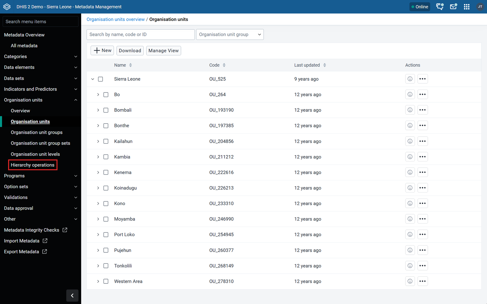

To move organisation units:

1. In the sidebar, click **Organisation units** > **Hierarchy operations**.
2. On the left, select the organisation units to move.
3. On the right, select the new parent.
4. Click **Move**. All descendants move with them.

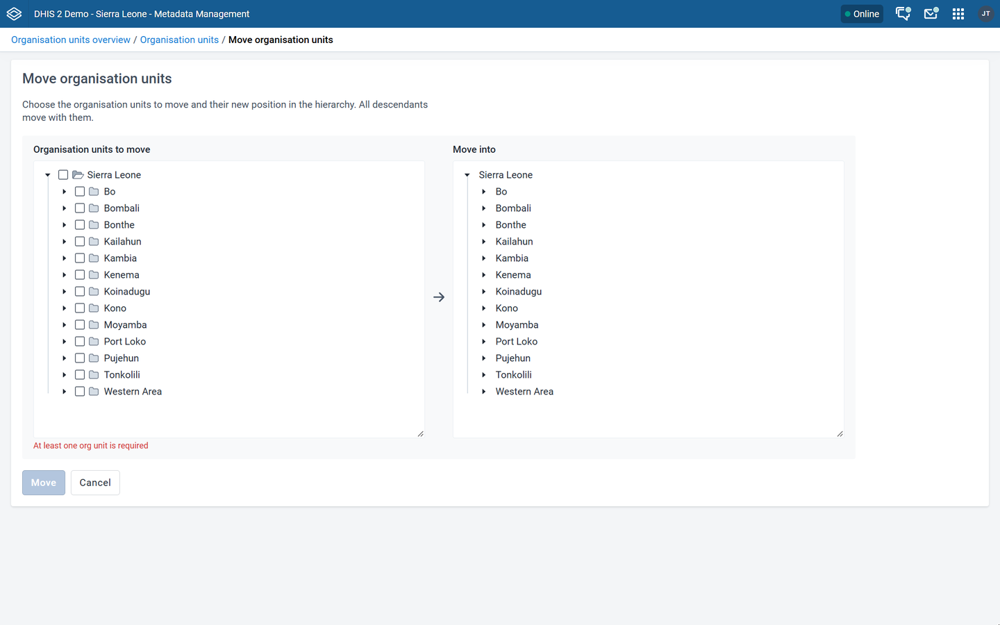

### Programs and data approval { #mmchg_programs_approval }

Programs and data approval are in the app's sidebar. They are documented separately.

## What you still need the Maintenance app for { #mmchg_maintenance_still_needed }

| Task | Why | What to do |
|---|---|---|
| Push reports | Not available in the Metadata Management app | Keep using the Maintenance app. See [Manage push reports](#manage_push_report). |
| External map layers | Planned to move to the Maps app | Keep using the Maintenance app until then. See [Manage external map layers](#manage_external_maplayer). |
| PDF data entry forms | Not in the data set options menu | Check if another app covers this on your instance. |

> **Important**
>
> Do not uninstall or hide the Maintenance app if your instance uses any of these.

## Checklist for system administrators { #mmchg_admin_checklist }

- Install or update the Metadata Management app from the App Hub.
- Give merge authorities only to users who clean up metadata.
- Check if your instance uses push reports or external map layers. If yes, keep the Maintenance app available.
- Tell users where the **Manage View** and **Download** buttons are. This is where most people look first.

## Related pages { #mmchg_related }

- [Configure metadata (Metadata Management app)](#metadata_management_app)
- [Configure metadata (Maintenance app)](#maintenance_app)
