# Data entry for aggregate data

As much as possible, data quality issues should be detected and addressed as early as possible. By the time data is entered into DHIS2, it will often have been recorded first on patient cards or registers, then manually tallied into tally sheets, before the data is aggregated into weekly, monthly, or quarterly values and recorded in aggregate facility reporting forms. Finally, data from these aggregate forms is entered into DHIS2. The design and quality of all these different tools, and the training provided and time allocated to staff to correctly perform these data collection activities, are critical for the quality of the data.

## Design of data entry

Design of the data collection forms is an often overlooked element of good data quality. Design of paper-based data collection tools and forms is beyond the scope of this document, but well-designed paper-based forms that are easy for data collection staff to fill out are an important factor in improving data quality. Forms that are extremely complex can be difficult to fill out on paper, which can lead to transcription errors on the original paper form. These errors can then carry over into the digital form (that is, DHIS2) when electronic data entry takes place.

[Data entry forms](https://docs.dhis2.org/en/use/user-guides/dhis-core-version-master/configuring-the-system/metadata-metadata-management-app.html#mm_manage_data_set) in DHIS2 can either be auto-generated (default or section forms) or have a custom design (custom forms). DHIS2 implementers can use HTML and JavaScript to create complex custom forms that closely mimic the layout and design of a paper form. DHIS2 generates section forms automatically. They consist of sections of data that share a common type of disaggregation. Section forms are generally easier to maintain and work well on mobile devices such as Android. Use section forms when possible. However, section forms might not match the design of paper forms. This can make data entry harder and make mistakes in the transcription process more likely.

Custom forms are sometimes necessary to make a data entry form that is easy to transfer from paper to digital. However, custom forms are sensitive to changes in the underlying metadata (for example, data elements and category dimensions). This can lead to data being entered into the incorrect data element/category option combination without the data entry user noticing it. Complicated custom forms can also need extra work to make “tabbing” between cells work correctly, which is important for efficient data entry without errors.

More generally, data entry forms that are overwhelmingly big (such as tables with 100+ rows x 10+ columns, not uncommon for recording morbidity data) come with the risk that the data entry user loses track of which row and column (for example, disease and age/sex disaggregation) they are entering data into.

This guide does not cover all aspects of creating data entry forms. Consider these items in your design before you configure any data set in DHIS2, because this can help prevent some data quality issues before they arise:

* What are the data elements on the form?
* Which period is the form going to be collected?
* Are there any disaggregations associated with the data elements that need to be made?
* Which organisation units should be reporting on the form routinely?
* Are there any items that can be automated, for example indicators or calculated totals?
* Are there any items you should collect using other means (population data, cumulative totals, and so on)?
* Design your dimensions with data use in mind, not data collection. 
    * This means that the disaggregation of data values at the time of collection should be easily aggregated up along the various dimensions, that is, they add up to a meaningful total.
* Reuse dimensions as much as possible, because this increases the ability to compare disaggregated data (for example, age groups, fixed/outreach, sex, and so on).

Configure data elements with the appropriate value types, so that only the right type of data values can be saved. For example, configure data elements for service delivery usage, cases/deaths, number of tests, and so on as zero or positive integers, to prevent negative numbers or decimals.

## Validation rules

[Validation rules](https://docs.dhis2.org/en/use/user-guides/dhis-core-version-master/configuring-the-system/metadata-maintenance-app.html#about_validation_rule) are a critical way to make sure that related data values follow defined patterns. For example, there cannot be more people who test positive for malaria than people who were tested for malaria. Similarly, if any people have tested positive for malaria, there should be at least as many people who were tested.

In DHIS2, validation rules consist of two values (a left side and a right side) that are compared using a mathematical operator (less than, greater than, and so on) to produce a logical true or false result. Validation rules compare values that are in DHIS2, at the level of capture and periodicity that the validation rule defines. Using the malaria example in the previous paragraph, a validation rule in DHIS2 can look like this:

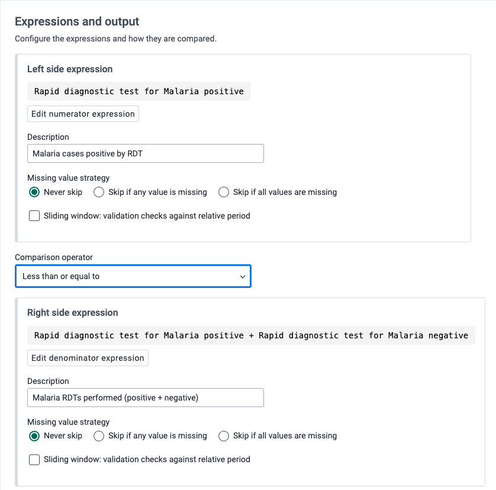{ .center width=60% }

If this data is collected monthly at the facility level, then it can be compared at least every month at the facility level, and additionally can be run at higher levels and lower frequencies if needed (for example, at district level for a year). 

Validation rules do not run when you work offline in the web-based Data entry app. They do work offline in the DHIS2 Android app on a mobile device.

### Configuring validation rules

This section shows how to create the validation rule from the previous example in the Metadata Management app. Malaria testing can use different methods, so this example rule is only for rapid diagnostic tests (RDT). The demo database has data elements for positive and negative RDT results, so the number of tests is the sum of the two.

In the **Metadata Management** app, go to **Validations** > **Validation rules** and click **New**. The form has three sections: **Basic information**, **Expressions and output**, and **Options**.

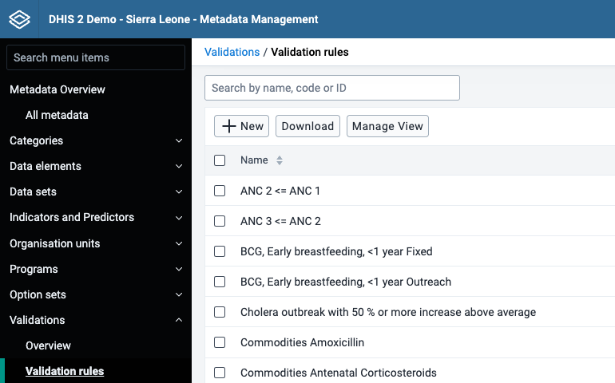{ .center width=65% }

#### Enter the basic information

In **Basic information**, enter a **Name** (required, unique). Make it descriptive, for example "MAL - Positive (RDT) &lt;= Tested (RDT)". You can also enter a short name, a code, and a description.

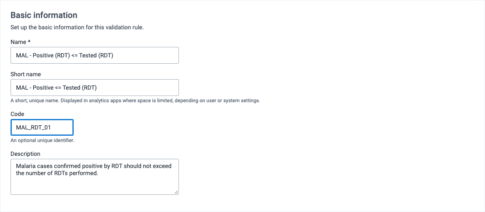

#### Create the expressions

To create the left side of the rule:

1. Under **Left side expression**, click **Set up numerator expression**. The **Edit numerator expression** window opens. (The app uses "numerator" for the left side and "denominator" for the right side.)
2. In the sidebar, open **Data elements**. Enter part of the name in the filter box, and click a data element to add it to the expression. Use **Operators** to add mathematical operators such as `+`.
3. Click **Validate**. The expression in plain words shows under **Valid expression**.
4. Click **Apply**.

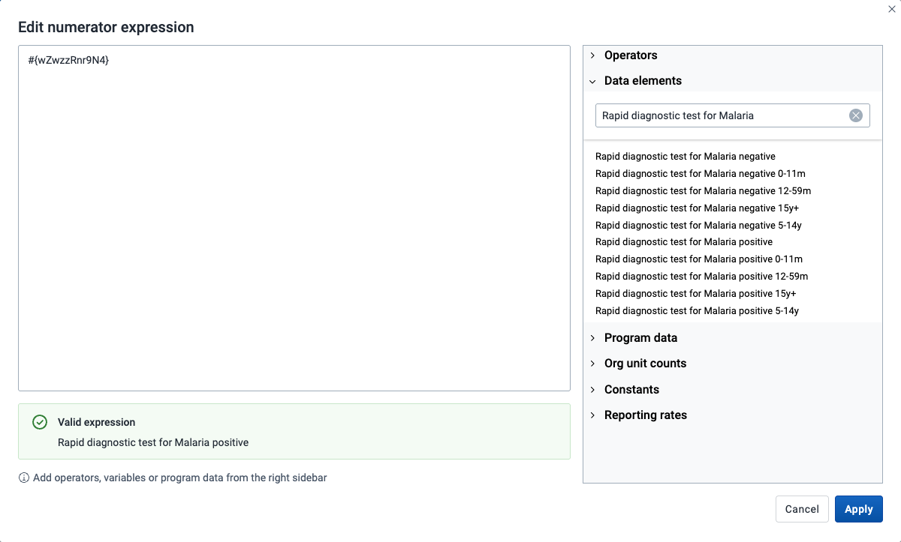{ .center width=95% }

5. Enter a **Description** for the left side. Users see the description in validation results, so make it short and clear.
6. Choose a **Missing value strategy**. It sets how DHIS2 evaluates the rule if data is missing:

| Option | Description |
|---|---|
| Never skip | DHIS2 always evaluates the rule and treats missing values as zero. This is the default option. Always choose this option if you use the **Compulsory pair** or **Exclusive pair** operator. |
| Skip if any value is missing | DHIS2 skips the rule if any of the values in the expression is missing. |
| Skip if all values are missing | DHIS2 skips the rule only if all of the values in the expression are missing. |

7. If you want to compare data relative to the period, choose **Sliding window: validation checks against relative period**. For more information, see [About validation rules](https://docs.dhis2.org/en/use/user-guides/dhis-core-version-master/configuring-the-system/metadata-maintenance-app.html#about_validation_rule).

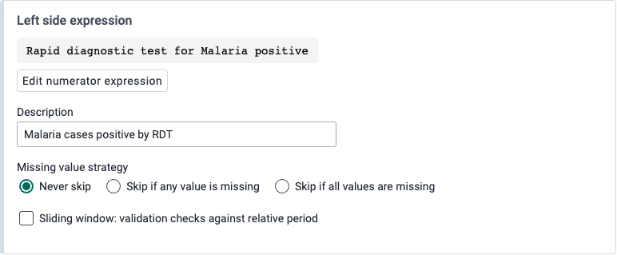{ .center width=70% }

> **Note**
>
> If a data element is disaggregated, you can add each disaggregation to the expression (for example, positive cases by age group) instead of the total. Validation rule analysis then shows the value of each disaggregation, which helps you find where the problem comes from.

Then choose the operator and create the right side:

1. Choose a **Comparison operator**: **Not equal to**, **Equal to**, **Greater than**, **Greater than or equal to**, **Less than**, **Less than or equal to**, **Compulsory pair**, or **Exclusive pair**. This example uses **Less than or equal to**.
    * *Compulsory pair* requires that data values are entered for both the left and right sides, or for neither side.
    * *Exclusive pair* requires that if any value exists on the left side, there are no values on the right side (or the reverse), for a given period, organisation unit, and attribute option combination.
2. Under **Right side expression**, click **Set up denominator expression** and create the right side in the same way as the left side.

The completed expressions show the left side, the operator, and the right side:

{ .center width=60% }

#### Set the output and options

1. Enter an **Instruction to show**. This field is not required, but users see it both in validation analysis and when they review validation rules during data entry, so always add one.
2. Choose a **Period type**. You cannot choose a period type more frequent than the frequency of data entry: if data is collected monthly, the period cannot be weekly.
3. Choose an **Importance** (**High**, **Medium**, or **Low**). DHIS2 shows the importance to users. It does not affect priority or whether the rule runs.

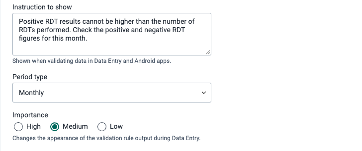{ .center width=65% }

4. In **Options**, choose the **Organisation unit levels to run validation for**. If you leave the field empty, DHIS2 evaluates the rule for all levels, which is the most common option.
5. Leave **Skip this rule during form validation in Data Entry App** cleared, so that users can review the rule during data entry.
6. Click **Save and close**.

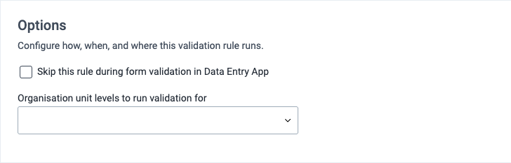{ .center width=65% }

#### Creating validation rule groups

After you create validation rules, group them. Groups of similar validation rules help in particular when you review the rules together in bulk analysis.

To create a validation rule group:

1. In the **Metadata Management** app, go to **Validations** > **Validation rule groups** and click **New**.
2. Enter a **Name**, and optionally a **Code** and a **Description**.
3. Under **Validation Rules**, move the related rules from **Available Validation rules** to **Selected Validation rules**.
4. Click **Save and close**.

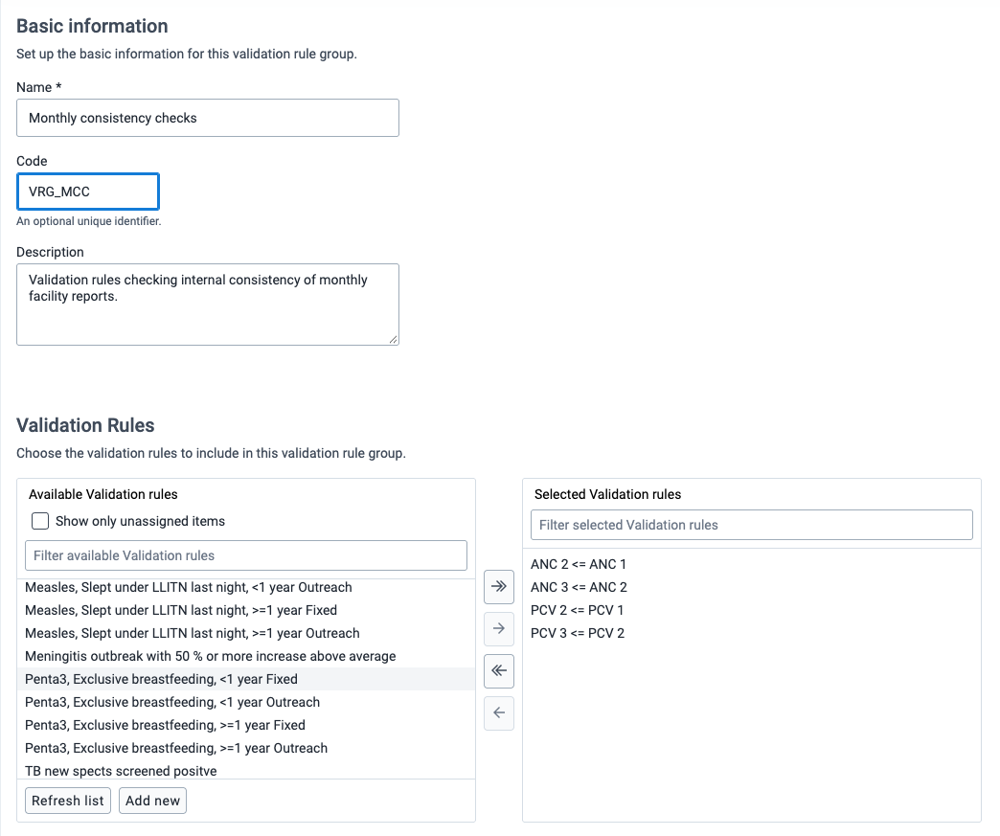{ .center width=75% }

The best way to define groups depends on how data elements and data sets are structured in a particular implementation. Examples are:

* A group with all validation rules linked to data elements in one specific data set (for example, a monthly data set for malaria reporting).
* A group with all validation rules linked to data elements in one particular section of a data set (for example, a malaria section of an integrated HMIS data set).
* A group with all validation rules linked to data elements across several related data sets (for example, across separate malaria testing and malaria treatment data sets).

#### Review validation rule violations in the data entry app

After you create the validation rules you need, use them to check your data routinely. You can review validation rules both in data entry and through [validation rule analysis](data-quality-03-analysis.md) in the Data Quality app. When you review validation rules, DHIS2 shows only the rules that are violated, not the rules that pass.

In the Data Entry app, click **Run validation** in the bottom bar at any time. Validation also runs when you click **Mark complete** to complete the data set.

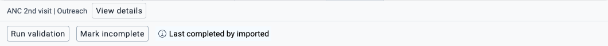{ .center width=95% }

The following example uses the rule "ANC 2 cannot be higher than ANC 1". The user typed 400 instead of 4 for ANC 2nd visit (outreach):

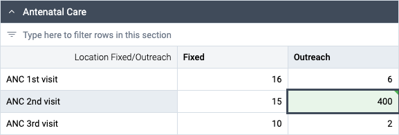{ .center width=55% }

The results show in the **Validation** panel on the right side of the app. The **Alert summary** shows the number of **High**, **Medium**, and **Low** priority violations. Each violation shows the instruction, then the left side and its value, the operator, and the right side and its value. The rule compares the totals of fixed and outreach visits, so the values in the panel (415 and 22) are larger than the values in the outreach cells.

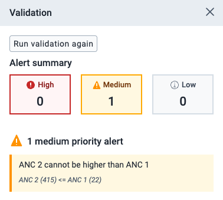{ .center width=30% }

Review the values for each of these rules, and correct them where you can before you continue with other work in DHIS2. In the example, the error is obvious, so correct the value to 4. When you have corrected all the errors that validation found for this data set, period, and organisation unit, click **Run validation again**. The panel shows that there are no validation alerts.

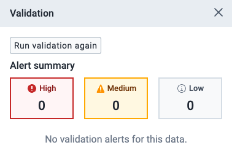{ .center width=30% }

Ideally, create validation rules before you train staff on data entry for a program. You can then include validation violations and how to correct them in the training. During training, make sure that all data sets pass validation, where possible, before submission.

#### Review validation rule violations in data entry (DHIS2 v41 and earlier)

To check the data in the previous Data entry app, scroll to the top or bottom of the data set and click **Run validation**. (Validation rules also run when you click **Complete** at the bottom of the data entry screen.)

{ .center width=85% }

This runs all validation rules that use data elements in the data set you chose.

A pop-up window shows the validation rules that are violated.

Review each of these rules to make sure that the data values in this data set are entered correctly before you finish data entry. If possible, correct wrong values to reduce errors at the source of collection.

### Validation rule notifications

Validation rule notifications let you create messages that DHIS2 sends when a validation rule is violated. A notification consists of the validation rules that trigger it, the recipients, and the message about the violation. DHIS2 can send notifications to recipients in three ways: email, SMS, and the DHIS2 internal messaging service. For more information, see the documentation on configuring [email](https://docs.dhis2.org/en/use/user-guides/dhis-core-version-master/configuring-the-system/system-settings.html?h=system+settings+master+use#system_email_settings) and [SMS](https://docs.dhis2.org/en/use/user-guides/dhis-core-version-master/maintaining-the-system/configure-sms.html). The following image shows an example of a validation rule notification sent by email.

{ .center width=65% }

When you create and use validation rule notifications, take care that recipients do not ignore the messages. Keep the number of notifications low, so that users do not receive too many messages. Experience shows that when users receive too many messages, they tend to ignore them, and real problems are not fixed. In general, create notifications only for priority areas of correction, and send them only to the users who need to see them. You can find other violations through routine data quality review procedures.

Validation rule notifications use user groups to define the recipients. To learn how to create a user group in DHIS2, see the [documentation on user groups](https://docs.dhis2.org/en/use/user-guides/dhis-core-version-master/configuring-the-system/users-roles-and-groups.html#mgt_usergroup).

#### Configuring validation notifications

In the **Metadata Management** app, go to **Validations** > **Validation notifications** and click **New**. Fill in the key fields:

1. Enter a **Name**, and optionally a code.
2. Choose the **Validation rules** that trigger this notification. To make messages easier to understand, use only one validation rule per notification where you can. If the recipients have access to several organisation units, there can be several violations in a given period, and the message identifies each violation.

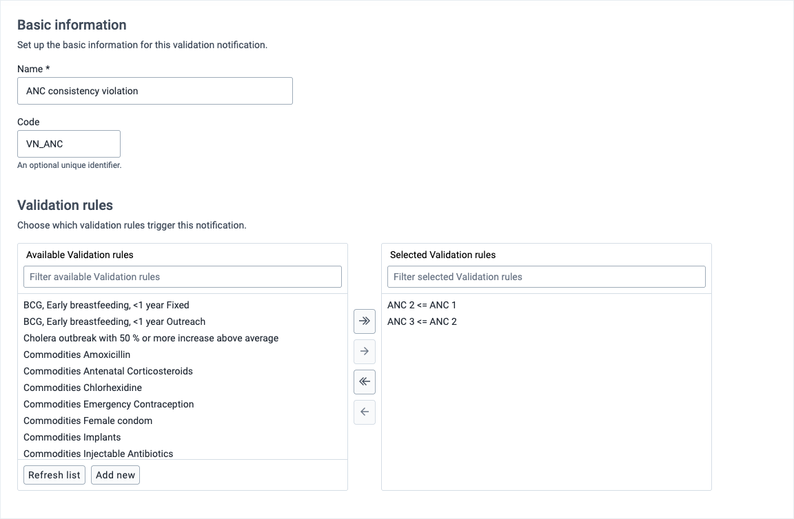{ .center width=95% }

3. Under **Notification details**, enter a **Message subject** and a **Message body**. The message consists of plain text and template variables that DHIS2 replaces with values. To add a variable, click it in the **Insert a variable:** list.
4. Under **Recipients**, choose the **User group recipients**. The user groups must exist (see the [documentation on user groups](https://docs.dhis2.org/en/use/user-guides/dhis-core-version-master/configuring-the-system/users-roles-and-groups.html#mgt_usergroup)). Users must have the relevant contact information filled in, for example an email address for email notifications. Choose only the users who need to receive and act on the information.
5. Under **Send notification as**, choose how DHIS2 sends notifications when it detects several violations (over several organisation units, periods, or both):
    * **Collective summary**: DHIS2 summarizes all detected violations in one email, SMS, or DHIS2 message.
    * **Single notification**: one message per violation. Use this option sparingly, for high priority violations.
6. Click **Save and close**.

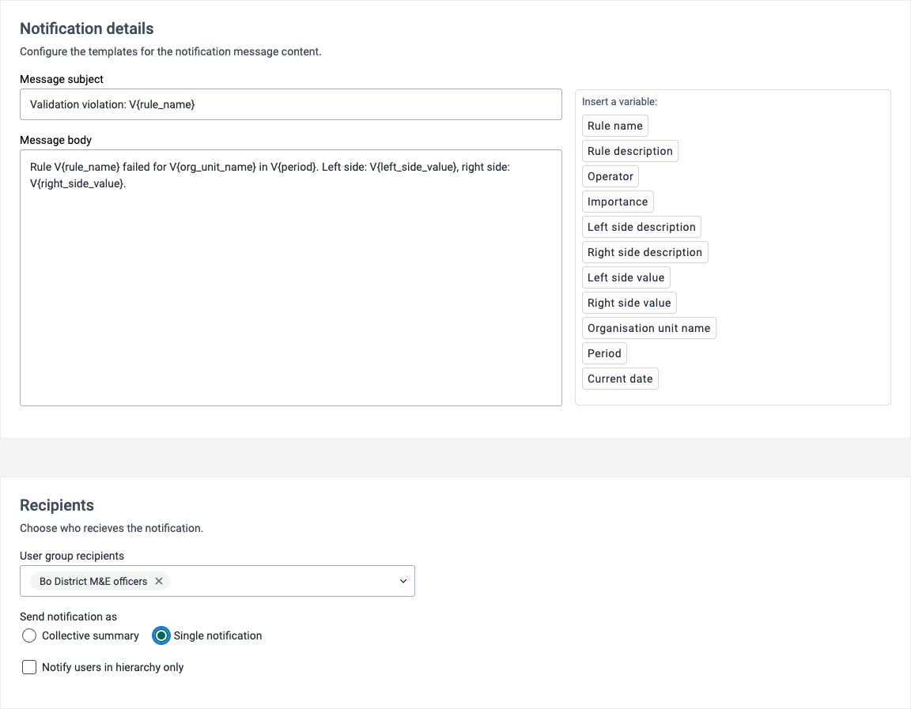{ .center width=80% }

The following example of a message shows how the template variables appear in a notification when DHIS2 sends it:

{ .center width=80% }

1. The subject. Each violation shows the subject before the contents of the message body.
2. The left side description, here Positive (RDT).
3. The left side value, taken from DHIS2.
4. The operator of the validation rule.
5. The right side description, here Tested (RDT).
6. The right side value, taken from DHIS2.
7. The organisation unit.
8. The period.

### Using validation rules to set an upper limit

Validation rules usually compare two related values. You can also use a validation rule to set a fixed upper limit for a set of data elements, to catch typing mistakes such as repeated digits. The `greatest()` function lets one rule check many data elements: it returns the largest of the values in the list.

The following example is from a school census in an education management information system (EMIS). The census form has 41 enrolment tables. The rule checks that the total of each table (all classes, sexes, and ages) is 3000 or less. In the census data from 2023 to 2025, 99.9% of these totals are below 1000, so a total above 3000 is almost certainly a mistake.

| Field | Value |
|---|---|
| Name | Enrolment plausibility: enrolment total over 3000 |
| Instruction | One of the enrolment tables in this form adds up to more than 3000 learners, which is more than any school is likely to have. Look through the enrolment tables for a value that is much larger than the others (often a typing mistake, such as repeated digits or a year) and correct it. |
| Importance | Medium |
| Period type | Yearly |
| Left side | `greatest(#{KrjARNwUOFF},#{w34HAnkMJDW},#{PPWh2jFXBWV}, ... ,#{pENhdbNXn7c})` (41 data elements), with the missing value strategy **Skip if all values are missing** |
| Operator | Less than or equal to |
| Right side | `3000`, with the missing value strategy **Never skip** |

Each data element in the list is referenced without a category option combination, so DHIS2 uses the total of all its disaggregations.

Compared with [min-max values](#min-max-values), this approach has some advantages. One rule covers a whole form, it does not need historical data for each organisation unit, and it works for yearly data with few data points. The limit is the same for all organisation units, so set it well above what the largest organisation unit reports. The rule also does not tell the user which table has the wrong value, because the left side shows only the largest total. Use the instruction to tell the user how to find it.

### Recommendation on validation rules configuration

Validation rules help prevent data entry errors. But if they are not configured in an appropriate way, they can also be a source of error by nudging users to “fix” mistakes.

In some cases, you might want to create validation rules for checks that are _most often_ real data quality problems, but that DHIS2 can flag falsely. An example of this is the comparison between women making their first (ANC1) and fourth antenatal care visit (ANC4). Across the whole population, the number of ANC1 visits should be greater than or equal to the number of ANC4 visits. Every woman making a fourth visit has also made the first visit, but inevitably some women do not come to their fourth appointment. So ANC4 should always be less than or equal to ANC1. However, this is _not appropriate as a validation rule_, because ANC visits are spread over several months, and women can make different visits in different health facilities. For example, a health facility can have 100 ANC 1 visits and 74 ANC 4 visits in a year (ANC 1 ≥ ANC 4), but in one month there could be 9 women making their 4th visit and only 8 making their first visit (ANC 1 &lt; ANC 4). This is not a data quality problem, but a validation rule comparing ANC1 and ANC4 would record it as one.

Do _not_ create validation rules in these cases. The validation rule warning can confuse the data entry user, and in the worst case they might edit the data to meet the validation rule criteria. If you _do_ create this type of validation rule, it show have low priority and the message to users should clearly say that they should examine the warning, but that it might not be an actual data quality problem in all cases.

Many of the aggregate metadata packages in the [health data toolkits](https://dhis2.org/metadata-downloads/) include examples validation rules for different health programs.

## Min-max values

The min-max functionality in DHIS2 is a set of features that lets you check for outliers in the data _during data entry_. The min-max value is based on setting minimum and maximum accepted values for a combination of data element, category option combination, and organisation unit. During data entry, DHIS2 highlights values outside these minimum and maximum thresholds in the data entry screen. As with validation rules, if a data value is outside the boundaries that the min-max values define, DHIS2 still lets you save the value. However, DHIS2 highlights the value in the data entry screen and shows a dialog that the user must acknowledge.

The min-max functionality has two main advantages:

* It lets you detect and flag data quality issues at the point of data entry, so that the person entering data can check the data right away and correct typos and so on.

* Min-max values can be set for any numeric data element that has a minimum of historical data, even when there is no logical relationships that lets you create validation rules.

For data sets disaggregated with an attribute category combination, the min-max values apply to all attribute option combinations.

### Configuring min/max values

You can set min-max values manually in the data entry app, or use methods that calculate minimum and maximum values from historical data with statistical methods. This guide does not recommend using the built-in DHIS2 tool to generate min-max values. For the reasons, see [Limitations with min/max values](#limitations-with-minmax-values).

You can view and _edit_ the min-max values in the Data Entry app. You can list values that *violate* the min-max thresholds in bulk with the Data Quality app, as described in [Review min-max values in the Data Quality app](#review-min-max-values-in-the-data-quality-app).

#### Viewing and configuring min/max values in the data entry app

In the Data Entry app, to see min-max values, choose an input field (that is, a cell for data entry) and click **View details** in the bottom bar. The **Details** panel opens on the right side of the screen. It has a section for **Min and max limits**.

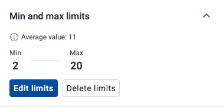{ .center width=30% }

All users can see the min-max values that are set. Users with the appropriate permissions can also edit or delete them. If no limits are set, the section shows **Add limits**.

#### Viewing and configuring min/max values in the data entry app (DHIS2 v41 and earlier)

In the Data entry app, double-click an input field (that is, a cell for data entry) to open a pop-up window with information about that data element and category option combination.

{ .center width=70% }

The **Min-max limits** section in the top right corner of the window shows the min-max limits that are set. Users with the appropriate permissions can remove limits or save new ones. These values then apply to that combination of data element, category option combination, and organisation unit. If a maximum value is set, the **Data element history** graph also shows it.

#### Built-in generator

DHIS2 can generate and remove min-max values in bulk for one or more data sets and a selection of organisation units. This function is in the Data Administration app. To generate or remove min-max values in bulk:

1. Open the **Data Administration** app.
2. Choose the **Min-Max Value Generation** section.
3. Choose one or more data sets for which you want to generate min-max values. DHIS2 generates or removes min-max values for all data elements with category option combinations in that data set.
4. Choose the organisation unit boundary to generate values for. DHIS2 generates or removes min-max values for all organisation units below the chosen organisation unit, including the chosen organisation unit itself.
5. Click **Generate min-max values** or **Remove min-max values**.

DHIS2 generates min-max values only for combinations of data element, category option combination, and organisation unit that already have data. This does not depend on how the data set is assigned.

{ .center width=75% }

DHIS2 generates min-max values by calculating the mean of all existing data values for a given combination of data element, category option combination, and organisation unit. It then calculates lower and upper bounds a certain number of standard deviations from this mean. The number of standard deviations comes from a system setting called **Data analysis std dev factor**. The default value is 2 standard deviations. You can change it in the System Settings app, in the **General** section.

{ .center width=60% }

##### Limitations with min/max values

As a general rule, do not use the Min-Max value generation tool with its current functionality. It has several major limitations that cause it to generate min-max values that are too restrictive. As a result, DHIS2 flags too many values as possibly wrong in the data entry app. This is a nuisance to data entry staff, and it can lead them to incorrectly edit values so that they are within the limits.

In _some_ cases this function can work well enough to use. This requires enough historical data for the statistical analysis, data that is reasonably normally distributed (that is, not seasonal and not changing over time), and no facilities that always report very low numbers. In reality, there are very few cases where this is true. In practice, one or more of these requirements are most often _not_ met:

* Some small health facilities consistently report very low numbers every month. In a hypothetical example, a health facility reports values of 2 or 3 every second month in one year. The thresholds at 2 standard deviations above and below the mean are 1.5 and 3.5. In other words, if the facility reports 1 or 4 in a month, the value is outside the threshold.

* Data is very often _not_ normally distributed. The typical example is data associated with rainy seasons, such as malaria. However, even data that is not typically considered seasonal has some months in the year with higher or lower numbers, for example reproductive health (and as a consequence immunizations, PMTCT, and so on).

* DHIS2 generates min-max values for all combinations of data element, category option combination, and organisation unit that have any value. For example, even if a health facility recently started reporting in DHIS2 and data exists for only a couple of months, DHIS2 generates min-max values, but from a very limited basis.

* The built-in min-max generation can use only the _mean_ of the existing data, so it is sensitive to any existing outliers.

#### Custom generation of min-max values

The [DHIS2 API](https://docs.dhis2.org/en/develop/using-the-api/dhis-core-version-master/maintenance.html#webapi_min_max_data_elements) lets you save and remove min-max values. You can therefore generate the min-max values outside DHIS2 with other tools, and then import them through the API. The API has bulk endpoints (`/api/minMaxDataElements/upsert` and `/api/minMaxDataElements/delete`) that take many values in one request, as JSON or CSV. These endpoints are available in DHIS2 2.41 and later. On older versions, the API lets you save or delete only one value at a time (for one combination of data element, category option combination, and organisation unit).

#### Generating min-max values with the DQ Workbench

The recommended way to generate min-max values is the [Data Quality Workbench](https://github.com/dhis2/tool-dq-workbench). This server-side tool has several data quality monitoring functions, and it can generate and routinely update min-max values through the DHIS2 API. It is designed to address the main shortcomings of the built-in min-max generation functionality:

* It lets you set different parameters according to the median values that organisation units report. For example, min-max for small facilities can be based on the previous highest values rather than standard deviations, while larger facilities can have a stricter statistical threshold.

* It lets you set a minimum completeness of historical data for a combination of data element and organisation unit before it generates min-max values for it, so that ranges are not based on sparse data.

* It supports several statistical methods that suit health data better than the built-in mean ± SD approach: previous maximum, z-score, median absolute deviation (MAD), interquartile range (IQR), and Box-Cox transformation (which normalizes the data before setting thresholds, to work better with data that is not normally distributed).

The [GitHub repository](https://github.com/dhis2/tool-dq-workbench) has detailed documentation on installation (Windows installer or Docker) and configuration. As with any bulk generation of min-max values, review the generated ranges in a test environment before you apply them to a production system.

#### Review min/max values in data entry

Users do not need to do anything to review min-max values in the Data Entry app. When someone enters a number outside the min-max limits, DHIS2 highlights the cell in yellow right away. In the following example, the max limit is 20:

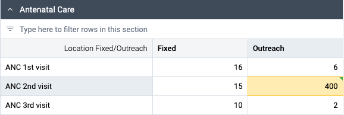{ .center width=55% }

The Data Entry app does not show a warning message, and **Run validation** does not list min-max violations. Explain the yellow highlight to data entry staff during training.

In the previous Data entry app (DHIS2 2.41 and earlier), a pop-up window with a warning message appears, and DHIS2 highlights the cell in dark orange. When you mark the data set as complete or click **Run validation**, that app also lists the min-max violations, in a similar way to validation rule violations.

{ .center width=60% }

{ .center width=90% }

#### Review min-max values in the Data Quality app

You can review min-max values in bulk with **Outlier detection** in the Data Quality app. **Min-max values** is one of the options in the **Algorithm** menu.

To analyze values outside the min-max thresholds:

1. Choose one or more data sets to analyze.
2. Choose one or more organisation units.
3. Set the start and end date.
4. Choose **Min-max values** as the **Algorithm**.
5. Click **Start**.

The result is a list that shows the data element, period, and organisation unit where a value outside the min and max thresholds was reported.

The **Value** column is the reported data value. **Deviation** is how far the number is above the max threshold or below the min threshold, and the **Min** and **Max** columns show the min-max thresholds for the data element and organisation unit. The table is sorted by deviation, because the violations with the highest deviation have the biggest impact on the overall data. **Follow-up** lets you mark data values for follow-up, so that you can review them later with the [Follow-up analysis](https://docs.dhis2.org/en/use/user-guides/dhis-core-version-master/collecting-data/data-quality.html?h=follow-up+anal+master+use#about-follow-up-analysis) function.
