# Assessing data quality

DHIS2 has a wide range of functions for assessing data quality, available across different apps and functions, and this section gives an overview of this functionality. It is structured according to three types of data quality metrics:

* Completeness and timeliness of data
* Consistency of data across related variables
* Consistency of data over time

Some of this functionality works without any configuration beyond the data sets and data elements themselves (for example reporting rates, scatter plots, and outlier tables), while other metrics require dedicated metadata to be configured for each variable that is assessed. The guidance in this section assumes DHIS2 version 2.41 or later.

## Configured data quality metrics

Three important data quality metrics require dedicated metadata to be configured for each variable (data element) you want to assess:

* *Data element completeness (%)*: the proportion of expected values for a data element that have actually been reported.
* *Facilities consistently reporting (%)*: the proportion of facilities reporting a data element every month over the last year, out of those reporting at all (counting only facilities with an established reporting history).
* *Outlier metrics (%)*: the proportion of reported values that are statistical outliers, and the value excluding outliers as a percentage of the total value.

From DHIS2 2.41, indicator expressions support the `subExpression()` function with multiple data elements and `periodOffset()` inside the expression. A subExpression is evaluated *per organisation unit and period at the level where data is registered*, before the result is aggregated over time and up the organisation unit hierarchy. With this, plain indicators can answer per-facility questions ("did this facility report this month?", "did it report in all of the last 12 months?", "is its value above its outlier threshold?") directly at analytics query time. Earlier versions of this guide instead relied on chains of [predictors](https://docs.dhis2.org/en/use/user-guides/dhis-core-version-master/configuring-the-system/metadata-metadata-management-app.html#mm_manage_predictor) and intermediate data elements for these calculations. This is no longer necessary or recommended (see the note on legacy configurations at the end of this section).

With this approach, the metadata needed per assessed data element is:

| Metric | What it measures | Metadata needed |
|---|---|---|
| Data element completeness (%) | 100 × (organisation units reporting a value) / (expected reports) | 1 indicator |
| Facilities consistently reporting (%) | 100 × (facilities reporting in *all* of the last 12 months) / (facilities with reporting history reporting in *any* of them) | 1 indicator |
| Values that are outliers (%) | 100 × (values above the outlier threshold) / (values that can be assessed) | 2 indicators, 1 predictor, 1 data element (shared) |
| Excluding outliers (%) | 100 × (sum of non-outlier values) / (sum of assessable values) | (shared with the previous row) |

In total: 4 indicators, 1 predictor and 1 data element per assessed variable. Only the *outlier threshold* is a stored value written by a predictor, because its calculation (median/MAD or mean/SD over a 12-month window) cannot be expressed in an indicator. The completeness and consistency indicators work as soon as analytics has run. You do not need to schedule anything for them, and there are no stored intermediate values that can go stale.

The metrics follow one common rule for missing data:

> Blank when the metric's required inputs are missing; 0 only when the metric is computed and genuinely zero.
>
> For example, a facility that cannot be assessed for outliers (no reported value, or no threshold yet) shows no value rather than a misleading 0% or 100%, and facilities in their first year of reporting are not counted in the consistency metric.

### Data Quality Configuration Helper Tool

The following sections document the expressions for each metric in full, and you can configure them by hand in the Maintenance app. However, the recommended way to set up these metrics is the [Data Quality Configuration Helper Tool](https://github.com/dhis2-utils/tool-dq-helper). From a single form, the tool generates, previews, and imports the complete set of metadata for a chosen data element (or one of its disaggregations), with consistent naming, descriptions, and metadata groups. It checks for naming conflicts before it creates anything. It also tracks what it has created, so that you can later review, edit (outlier threshold), or remove configurations cleanly.

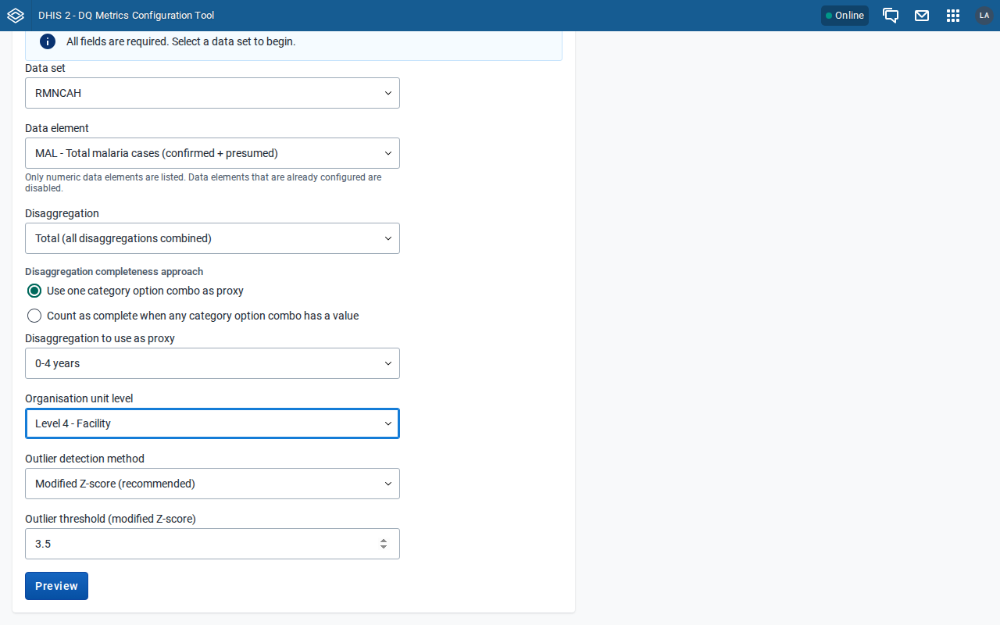

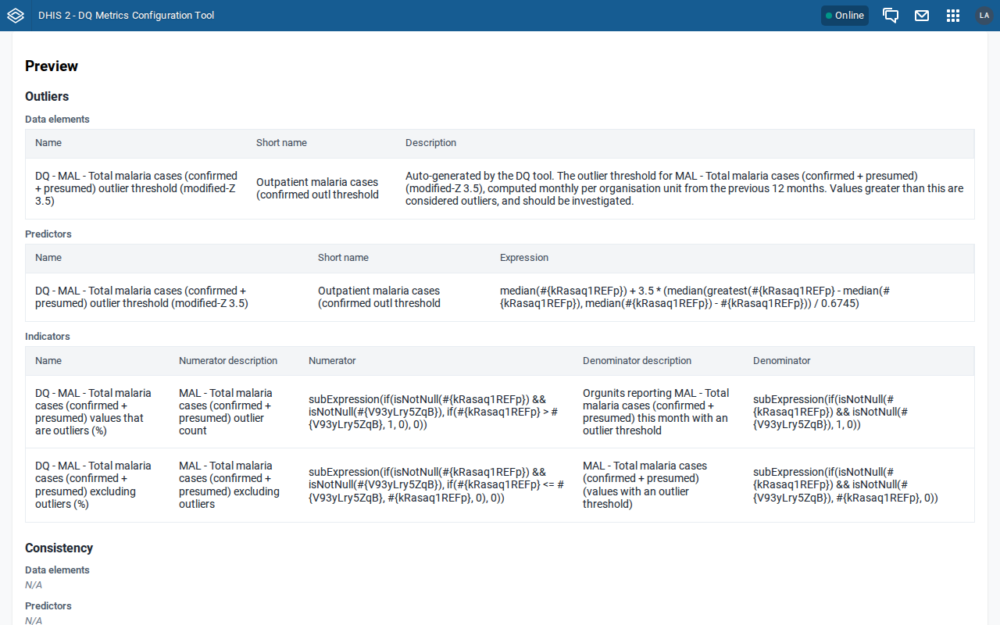

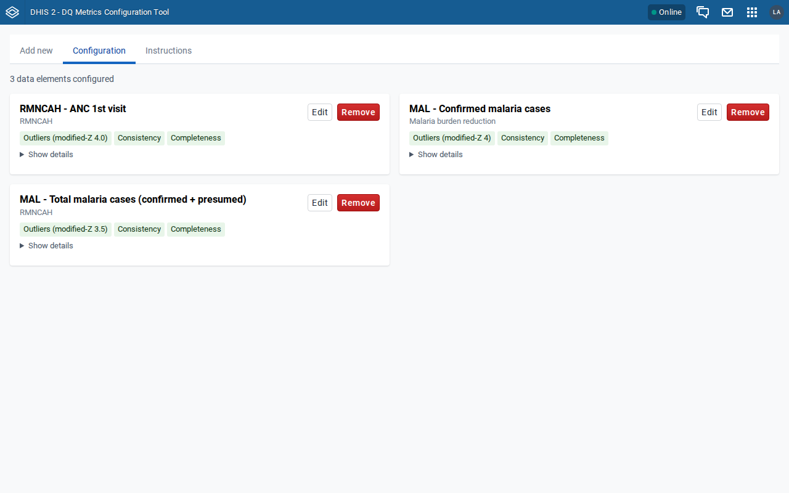

Refer to the tool's user manual for step-by-step instructions. This guide focuses on the *principles and expressions* behind the metrics, which apply whether the tool generates the metadata or you configure it manually.

### Practical considerations

* Scheduling: only the outlier threshold predictor needs a scheduled job. A single *predictor* job covers the threshold predictor(s), typically nightly before the analytics job. There are no ordering dependencies between predictors. The completeness and consistency indicators require only the normal analytics job. See the [scheduling section](data-quality-04-implementation.md) for details.
* Monthly data: the expressions documented here are designed for *monthly* data elements. The 12-month windows inside the indicators follow the period type of the analytics *query*: used in a quarterly or yearly layout, "last 12 months" silently becomes "last 12 quarters/years". Use these indicators in monthly layouts only.
* Zero values: the indicators read the *analytics tables*, which by default do not include stored zero values for data elements with aggregation type Sum. As a result, `isNotNull(...)` counts facilities reporting a *non-zero* value. For most variables this makes no difference, because facilities either report a positive number or report nothing. But for variables where reporting zero is normal and meaningful (stock-outs, notifiable diseases, HIV cascade variables), all the configured metrics silently shrink to the non-zero-reporting population. See the zero value discussion under [data element completeness](#calculating-data-element-completeness) for the two ways to handle such variables.
* Choose variables deliberately: even though the configuration burden is now modest, each assessed variable still adds metadata to the system. Configure the metrics for core indicators, as discussed in the [implementation section](data-quality-04-implementation.md).
* Analytics backend: instances running the experimental Doris analytics backend are not yet supported, because subExpression indicators currently generate PostgreSQL-specific SQL ([DHIS2-21793](https://dhis2.atlassian.net/browse/DHIS2-21793)).
* Performance: the query cost of these indicators is negligible for the visualization types they are designed for (monthly values, aggregated trends, single values). Very large facility-level pivot tables covering many months of the outlier indicators are the one pattern that can be noticeably slower (seconds rather than sub-second on large databases).

> **Note**
>
> This note is about legacy predictor-based configurations. Earlier versions of this guide (and of the configuration tool) implemented these metrics with chains of up to 8 predictors and 8 intermediate data elements per variable. Existing configurations of this kind keep working on DHIS2 2.41-2.42 and produce the same aggregated values, so there is no urgency to migrate. However, on DHIS2 2.43 (as of 2.43.1, not yet fixed), predictors configured with organisation units providing data set to "at selected level(s) only" (`SELECTED`) silently stop producing values. This affects most predictors generated under the old guidance. A tell-tale sign is threshold and consistency values that stop appearing for new periods after an upgrade. The workaround is to change the affected predictors to include descendants (`DESCENDANTS`). The more durable fix is to remove the old configuration and re-create it with the Data Quality Configuration Helper Tool.

## Completeness and timeliness

*Completeness* of reporting gives an indication of how much of the expected data has actually been reported. In DHIS2, most of the completeness checks are based on assessing the _data set_ completeness, that is, how many data sets (forms) have been submitted by organisation unit and period. The timeliness calculation is based on a per-data-set setting, **Days after period to qualify for timely submission** (see [configuring data set timeliness](#configuring-data-set-timeliness)).

The built-in functionality for completeness and timeliness in DHIS2, for example in the Data Visualizer, Reports, and Maps apps, refers to *data set reporting rates*. However, you can also configure DHIS2 to assess the proportion of facilities that are _consistently reporting_, as well as the *completeness of individual data elements*.

### Data set completeness and timeliness

The completeness reports also show which organisation units in an area are reporting on time, and the percentage of timely reporting facilities in a given area.

You can review data set completeness and timeliness in the Reports app as well as in the core visualization apps (Data Visualizer and Maps). In the core visualization apps, you can review completeness and timeliness in more detail across multiple organisation units and periods.


#### Using Data Visualizer

In Data Visualizer you can review the same data set completeness and timeliness measures. You can combine multiple data sets, periods, and organisation units, and combine completeness metrics with other data (such as health service delivery data) in the same chart or table. Ideally, such visualizations are pre-made and placed on dashboards for users to review routinely, but it is useful for a subset of users to know how to create them.

In Data Visualizer, open the **Data** dimension and choose **Data sets** as the **Data Type**. You can then choose the data set and metric (reporting rate, reporting rate on time, actual reports, actual reports on time, expected reports) to use in the visualization.

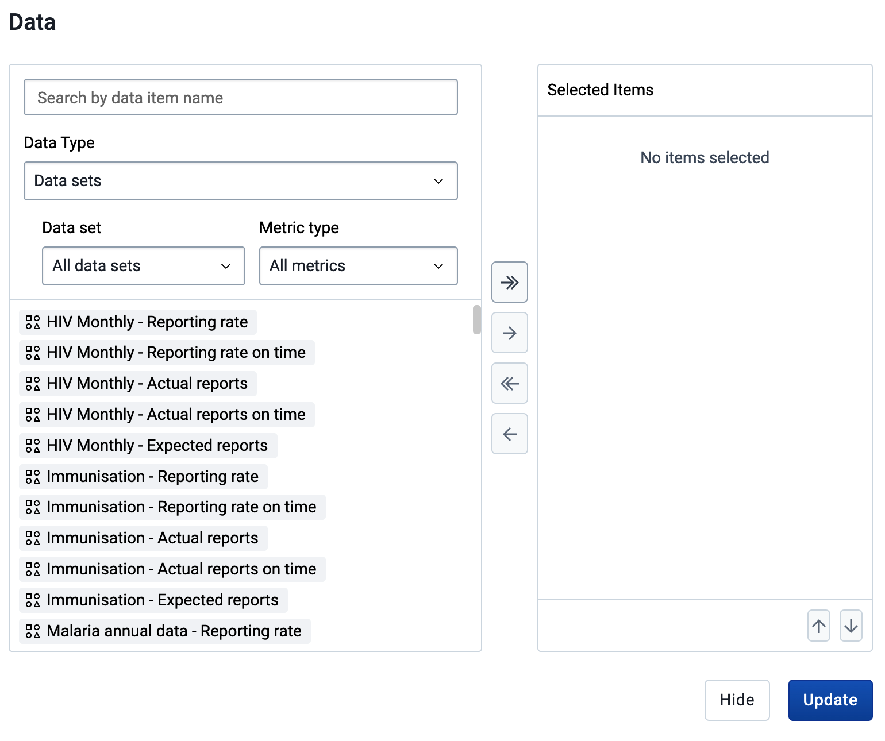

Here is an example of a chart comparing BCG doses given with the reporting rate of the immunization data set:

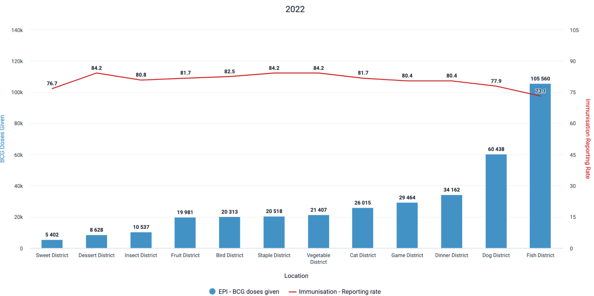

Several districts have reporting rates below 80%, so the service data shown might not represent the actual situation. It might be important to verify this through a more detailed analysis of the facilities affecting this value and/or using data element completeness.

As another example, you can also create a pivot table that compares completeness and timeliness over several data sets, periods, and organisation units as follows:

* Choose **Pivot table** as the visualization type.
* In the **Data** dimension, set the data type to **Data sets** and choose the metrics you want to compare.

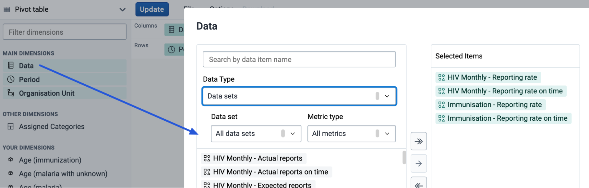

* Choose your periods and organisation units.
* Modify the layout, for example with data and periods as columns and organisation units as rows, and click **Update**.

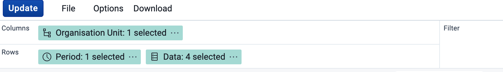

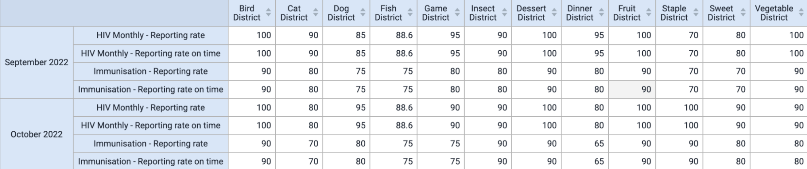

You can use the same selections with other visualization types. For example, use a line chart of reporting rates over the last 12 months to monitor trends, or a combination chart with service data as columns and the reporting rate on a second axis (set under **Options** > **Series**):

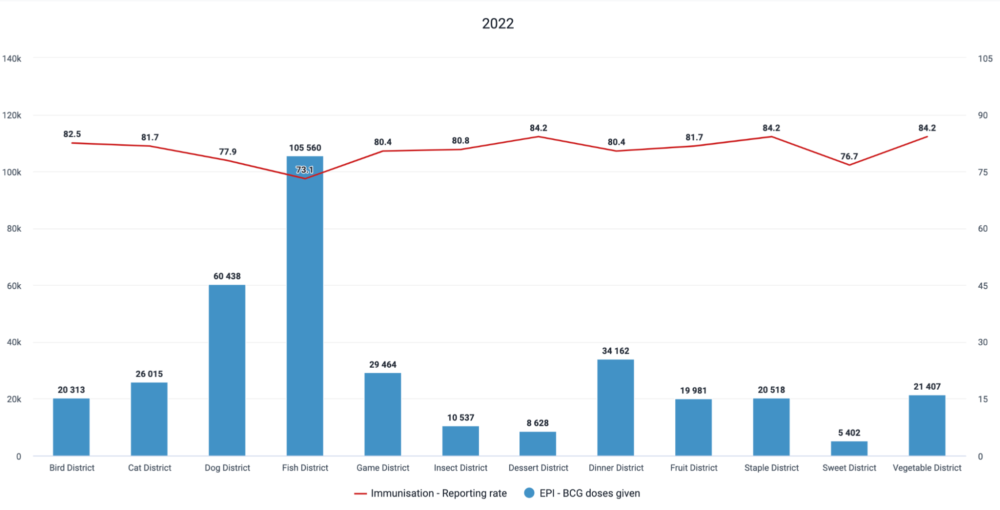


#### Using the Reports app

To review completeness and timeliness in the **Reports** app, open the app and click **Get Report** under **Reporting Rate Summary**.

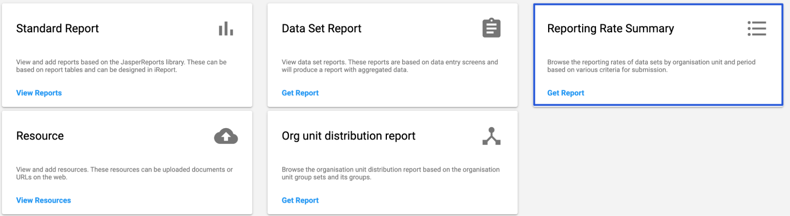

Choose your inputs:

1. The organisation unit you want to review. Choose the parent organisation unit. The report includes all of its children, along with the overall result for the chosen organisation unit.
2. The data set you want to review.
3. The reporting period type, followed by the period itself.

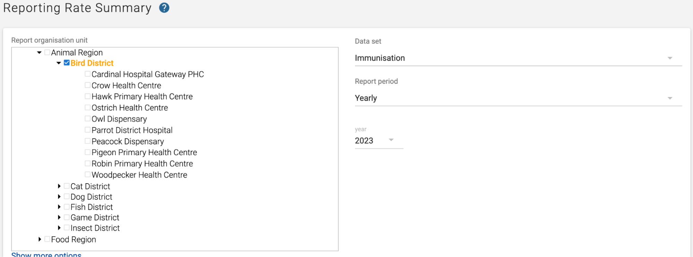

Under **Show more options**, you can filter the report using an organisation unit group set. Click **Get report** to produce the report.

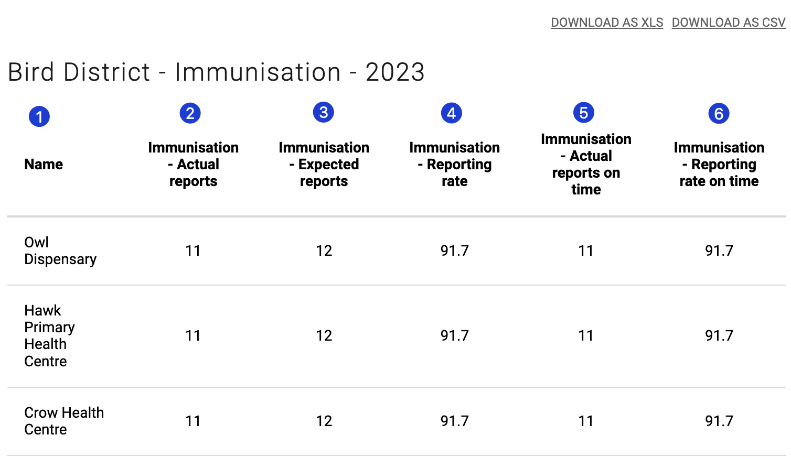

The report has the following columns:

1. Name: the name of the organisation unit
2. Actual reports: the number of reports within the selected period that were marked as complete
3. Expected reports: the number of expected reports within the period, calculated from the data set's organisation unit assignment
4. Reporting rate: actual reports / expected reports × 100%
5. Actual reports on time: the number of reports marked as complete within the timeframe defined as "on time" for the selected data set
6. Reporting rate on time: actual reports on time / expected reports × 100%


#### Configuring data set completeness

Data set completeness is based on the organisation unit assignment of your data set, which determines the value for expected reports based on the periodicity of the data set. You configure this in the **Maintenance** app: go to **Data set**, choose or create the data set, and scroll to the organisation unit assignment at the bottom.

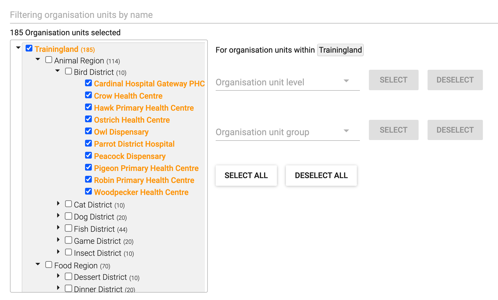

You can assign your data set to organisation units by choosing them one by one, or by using levels or groups.

Make sure that the data set is *not* assigned to any organisation units that are not expected to report on it. Otherwise, the number of expected reports is consistently incorrect. For example, if a monthly data set is assigned to 185 organisation units but only 160 of them actually provide the service and report, completeness can never exceed 160/185 = 86% in any given month. Conversely, de-assigning organisation units because they never report even though they should have will give completeness figure that is too high. Correct and up-to-date data set assignment is a prerequisite for meaningful completeness data.

#### Configuring data set timeliness

You also configure timeliness in the Maintenance app when you create or edit a data set, using the **Days after period to qualify for timely submission** field.

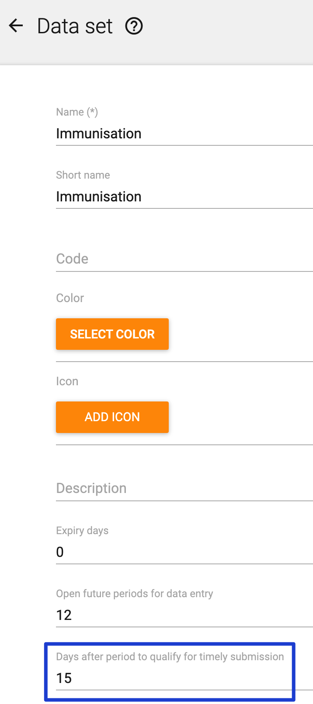

In this example, the data set is collected monthly and the timeliness is set to 15. This means that the data set must be completed within 15 days after the end of the month to qualify as a timely submission.

### Data element completeness

Data set completeness and timeliness are useful measures to monitor the overall reporting performance of the system. However, several conditions need to be met for the data set completeness to give a representative indication of completeness of the data within the data set:

* Users must remember to mark the data set as complete when data has been entered
* Users must actually enter data in the form before marking it as complete
* Assignment of the data set to organisation units (facilities) must be correct

Often, one or more of these conditions are _not_ met, which means that it is necessary to also do additional analysis of the reporting completeness. This section shows:

* How to analyze the proportion of facilities that _consistently report_ data element values over a time period
* How to analyze completeness of an individual data element

Both are among the [configured data quality metrics](#configured-data-quality-metrics): they require one indicator per assessed data element, which you can generate with the Data Quality Configuration Helper Tool or configure manually as described here. Make visualizations using the indicators and share them with users. Organize the metadata in groups (the configuration tool does this automatically). \[PLACEHOLDER: link to demo instance with updated DQ configuration\]

#### Orgunits consistently reporting

Assessing the proportion of facilities that _consistently report_ over a time period adds another dimension to the understanding of data completeness. When a subset of facilities report intermittently, overall completeness figures can remain stable while the underlying data varies substantially. For example, if in one month a dispensary reports and a district hospital does not, and the next month it is the opposite, the completeness numbers are constant but the reported service data is likely quite different.

This guide defines facilities consistently reporting as: 100 × (facilities reporting *every* period within a time period) / (facilities reporting in *any* period within that time period).

In principle, you can do this check based on the overall data set reporting or on a data element within the data set. This guide shows the latter, because you can assess this at the data set level by looking at the annual data set reporting rate for individual facilities.

The metric is a single indicator. Using ANC 1 (first antenatal care visit), collected monthly, as an example:

* Name, short name, code and description according to local naming conventions, for example "ANC 1 - facilities consistently reporting last 12 months (%)"
* The indicator should not be annualized, and the indicator type should be Percentage (factor = 100)
* Numerator: facilities that reported in *all* of the previous 12 months (replace `DE_UID` with the data element UID):

```
subExpression(
    if( if(isNotNull(#{DE_UID}.periodOffset(-1)), 1, 0)
      + if(isNotNull(#{DE_UID}.periodOffset(-2)), 1, 0)
      + if(isNotNull(#{DE_UID}.periodOffset(-3)), 1, 0)
      + if(isNotNull(#{DE_UID}.periodOffset(-4)), 1, 0)
      + if(isNotNull(#{DE_UID}.periodOffset(-5)), 1, 0)
      + if(isNotNull(#{DE_UID}.periodOffset(-6)), 1, 0)
      + if(isNotNull(#{DE_UID}.periodOffset(-7)), 1, 0)
      + if(isNotNull(#{DE_UID}.periodOffset(-8)), 1, 0)
      + if(isNotNull(#{DE_UID}.periodOffset(-9)), 1, 0)
      + if(isNotNull(#{DE_UID}.periodOffset(-10)), 1, 0)
      + if(isNotNull(#{DE_UID}.periodOffset(-11)), 1, 0)
      + if(isNotNull(#{DE_UID}.periodOffset(-12)), 1, 0) == 12,
    1, 0))
```

* Denominator: facilities that reported in *any* of the previous 12 months, *and* that have a reporting history (at least one value in months -12 to -24). In the following expression, the first sum is the history condition (offsets -12 to -24), and the second is "reported in any of the last 12 months" (offsets -1 to -12):

```
subExpression(
    if( if(isNotNull(#{DE_UID}.periodOffset(-12)), 1, 0)
      + if(isNotNull(#{DE_UID}.periodOffset(-13)), 1, 0)
      + if(isNotNull(#{DE_UID}.periodOffset(-14)), 1, 0)
      + if(isNotNull(#{DE_UID}.periodOffset(-15)), 1, 0)
      + if(isNotNull(#{DE_UID}.periodOffset(-16)), 1, 0)
      + if(isNotNull(#{DE_UID}.periodOffset(-17)), 1, 0)
      + if(isNotNull(#{DE_UID}.periodOffset(-18)), 1, 0)
      + if(isNotNull(#{DE_UID}.periodOffset(-19)), 1, 0)
      + if(isNotNull(#{DE_UID}.periodOffset(-20)), 1, 0)
      + if(isNotNull(#{DE_UID}.periodOffset(-21)), 1, 0)
      + if(isNotNull(#{DE_UID}.periodOffset(-22)), 1, 0)
      + if(isNotNull(#{DE_UID}.periodOffset(-23)), 1, 0)
      + if(isNotNull(#{DE_UID}.periodOffset(-24)), 1, 0) > 0
     && if(isNotNull(#{DE_UID}.periodOffset(-1)), 1, 0)
      + if(isNotNull(#{DE_UID}.periodOffset(-2)), 1, 0)
      + if(isNotNull(#{DE_UID}.periodOffset(-3)), 1, 0)
      + if(isNotNull(#{DE_UID}.periodOffset(-4)), 1, 0)
      + if(isNotNull(#{DE_UID}.periodOffset(-5)), 1, 0)
      + if(isNotNull(#{DE_UID}.periodOffset(-6)), 1, 0)
      + if(isNotNull(#{DE_UID}.periodOffset(-7)), 1, 0)
      + if(isNotNull(#{DE_UID}.periodOffset(-8)), 1, 0)
      + if(isNotNull(#{DE_UID}.periodOffset(-9)), 1, 0)
      + if(isNotNull(#{DE_UID}.periodOffset(-10)), 1, 0)
      + if(isNotNull(#{DE_UID}.periodOffset(-11)), 1, 0)
      + if(isNotNull(#{DE_UID}.periodOffset(-12)), 1, 0) > 0,
    1, 0))
```

Each `if(isNotNull(#{DE_UID}.periodOffset(-n)), 1, 0)` term contributes 1 if the facility has a value *n* months before the reporting period. The two windows overlap at month -12: a facility that started reporting exactly 12 months ago and has reported every month since satisfies both the numerator and the history condition, so the numerator can never exceed the denominator. The subExpression is evaluated per facility, so the indicator counts facilities. A data element referenced inside a subExpression refers to the facility's total across all disaggregations, so the same expression works for disaggregated and non-disaggregated data elements alike. As noted in the [overview](#configured-data-quality-metrics), use this indicator in monthly visualisations only.

How to interpret the values, following the blank-vs-zero rule:

* A facility that reported in all of the last 12 months counts 100%; one that reported in only some of them counts 0% towards the aggregated percentage.
* A facility with *no* reporting history 12-24 months back (for example, newly opened or newly reporting) is excluded entirely. It shows a blank rather than dragging down the aggregated consistency during its first year.
* A facility with history but no reports at all in the last 12 months is also excluded (it is no longer an active reporter, which is better assessed with the completeness metrics).

#### Calculating data element completeness

In some DHIS2 implementations, reporting is inconsistent for individual data elements within a data set even when the data set itself is submitted. By default, DHIS2 assesses only the reporting rates of data sets, not of individual data elements. The goal of a data element reporting rate is to assess the reporting consistency of a single variable. This applies to aggregate data elements only.

A reporting rate is: 100 × (number of received values / number of expected values)

To calculate the reporting rate for a data element, you define an indicator with a numerator (values received) and a denominator (expected values), with indicator type Percentage (factor 100). The numerator is always a count of reported values. For the denominator there are several options, and the appropriate choice depends on the specific implementation and what you want to measure with the metric.

#### Configuring the numerator: values received

The numerator is the count of organisation units with a data value for the data element (or a specific disaggregation of it). There are a few things to consider.

**Zero value storage**

In general, do _not_ store zero values for data elements unless there is a clear reason to do so. This has implications for data element completeness: where zeros are not stored, you cannot tell apart facilities that have 0 to report and facilities that have not reported. One option is to enable zero value storage for the specific data elements being assessed. This is difficult in practice, because data entry users must then know for which fields a 0 is expected. A more practical option is to focus data element completeness on data elements where all or almost all facilities are expected to have a value > 0 to report. Be explicit in the descriptions of the indicator and visualizations that 100% completeness is not necessarily expected.

For data elements where zero values *are* stored (**Store zero data values** enabled) and the aggregation type is **Sum**, there is an additional factor that is often missed. Stored zeros do not reach the *analytics tables* unless the system setting **Include zero data values in analytics tables** (**System Settings** > **Analytics**) is also enabled. This setting is off by default, to limit analytics table size. Because the configured metrics are indicators that read analytics, `subExpression( if( isNotNull(#{DE}), 1, 0))` then counts facilities reporting a *non-zero* value. Completeness can drop dramatically, while the consistency and outlier metrics quietly compute over the non-zero-reporting facilities only. Their ratios still look plausible, which makes the problem hard to spot. (Data elements with an average aggregation type are not affected; their zeros are always included in analytics. Predictors are also not affected, because they read the stored data values directly.)

For such data elements, there are two options:

1. Ensure zero values are included in analytics. Enable the **Include zero data values in analytics tables** system setting, in addition to **Store zero data values** on the data element. All the configured metrics then count zero-reporting facilities correctly, with no additional metadata. The setting is *global*: it applies to every data element that stores zeros, it increases the size of the analytics tables (assess the volume of stored zeros before enabling it on a large instance), it requires an analytics table rebuild to take effect, and it can change the value of any other indicator that distinguishes zero from blank.

2. Keep a predictor for the completeness numerator (the approach used before 2.41). Predictors read stored data values directly, so zeros are counted. Create an output data element and a predictor with the generator `if( isNotNull(#{DE_UID}), 1, 0)`, period type matching the data, the data collection level as organisation unit level (including descendants), and all sample counts set to 0. Use the output data element as the completeness numerator. This is local to the variable (two extra objects, and the predictor must be included in the scheduled predictor job). However, the *consistency and outlier metrics* for the variable still see only the non-zero reporters. State this in their descriptions, or use option 1 instead.

A quick way to check whether a variable is affected: compare the completeness numerator's value for a recent month against the number of facilities with a stored value for that month (for example from the old configuration's stored completeness count, or a count of data values through the API). Any material gap means stored zeros are being excluded.

**Disaggregations**

For data elements with disaggregations, you must decide what "reported" means. For example, if a child vaccination data element such as BCG is disaggregated by "< 1 year" and "1+ year", should completeness be based on:

* One specific category option combination (used as a proxy). For example, "reported" means having a value for "BCG doses < 1 year". This makes sense when one disaggregation is clearly the primary one: for BCG, the target group is < 1 year, and many facilities might have nothing to report for 1+ year.
* Any category option combination. For example, "reported" means having a value for either age group. This makes sense when it is the data element as a whole that matters.
* All (or each) category option combinations. For example, "Confirmed malaria cases" disaggregated into < 5 and 5+ years, where facilities can be expected to report both values.

The same consideration applies when data sets are disaggregated with an [attribute option combination](https://docs.dhis2.org/en/use/user-guides/dhis-core-version-master/understanding-the-data-model/additional-data-dimensions.html), though this is less common.

The following table shows the numerator expressions for each approach. A key property to be aware of: *a data element referenced inside a subExpression without a category option combination refers to the facility's total across all disaggregations*. As a result, a plain `isNotNull(#{DE})` test counts facilities reporting *any* disaggregation.

| Approach | Numerator expression (example UIDs) |
|---|---|
| No disaggregation | `subExpression( if( isNotNull(#{TWWbtMMWD51}), 1, 0))` |
| Disaggregated: one category option combo as proxy | `subExpression( if( isNotNull(#{TWWbtMMWD51.JKuWbG5bWAu}), 1, 0))` |
| Disaggregated: any category option combo counts as reported | `subExpression( if( isNotNull(#{TWWbtMMWD51}), 1, 0))` |
| Disaggregated: all category option combos must have a value | `subExpression( if( isNotNull(#{TWWbtMMWD51.JKuWbG5bWAu}) && isNotNull(#{TWWbtMMWD51.UIQxmxgioxH}), 1, 0))` |
| Disaggregated: counting each category option combo with a value | `subExpression( if(isNotNull(#{TWWbtMMWD51.JKuWbG5bWAu}),1,0) + if(isNotNull(#{TWWbtMMWD51.UIQxmxgioxH}),1,0))`. Adjust the denominator accordingly, for example expected reports × number of category option combos: `R{tQc4Gv2Jwco.EXPECTED_REPORTS} * 2` |

The Data Quality Configuration Helper Tool supports the first three approaches directly (for the disaggregated cases, you choose between a proxy category option combo and "any disaggregation counts").

#### Configuring the denominator: expected values

There are several ways to define the "expected values" denominator:

1. Count of organisation units to which the data set(s) containing the data element is assigned
2. Count of organisation units for which the data set(s) containing the data element has been marked as complete
3. Count of reported values of another data element
4. Count of organisation units that have previously reported on the data element itself

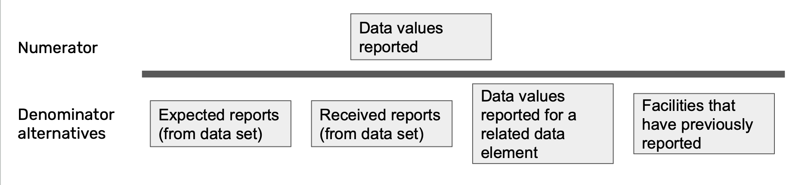

Which option is appropriate depends on contextual factors. These include how correct and up to date the data set assignment is, and whether the purpose is to look at the overall completeness of the data element (how much of the true figure is captured) or the completeness within a data set (how completely are staff filling in the reporting form).

##### Option 1: count of organisation units to which the data set is assigned

Use the *expected reports* of the data set that the data element is part of. This measure is similar to how data set completeness (reporting rates) works. You can configure it directly, because expected reports are available in indicator expressions:

```
R{tQc4Gv2Jwco.EXPECTED_REPORTS}
```

The main limitation is that it assumes the data set assignment is correct and kept up to date. Take special care if the same data element is reported through multiple data sets. If the data sets are used in different organisation units, adding up the expected reports of each data set gives a correct denominator. If the same organisation unit might have both data sets assigned, this option is not reliable.

##### Option 2: count of organisation units for which the data set has been received

Identical to option 1, but using *actual reports* (`R{tQc4Gv2Jwco.ACTUAL_REPORTS}`) instead of expected reports. This gives an indicator that assesses the completeness of the data element *among the organisation units that reported*, that is, how often a particular data element is filled in within the forms that are actually submitted. The same multiple-data-set caution as for option 1 applies.

##### Option 3: count of reported values of another data element

Use the count of values reported for another data element as the expected values. The comparison data element can be chosen on different grounds:

* _A data element in the same data set_ that is always (or most often) reported. For example, in a maternal health data set, more facilities will likely report "ANC 1st visits" than "Assisted deliveries", so ANC 1 is a reasonable estimate of the number of facilities that submitted the form.
* _The denominator of a core indicator._ If the data element being assessed is the numerator of a key performance indicator with routinely reported data in the denominator, using the count of denominator values is recommended, because it directly indicates the consistency of data used for that indicator. Example: for "Suspected cases tested for malaria (%)" = 100 × (malaria tested cases / suspected cases), assess the completeness of "malaria tested cases" against the count of "suspected cases" values.
* _A closely related data element._ For example, for inpatient malaria cases under 5, the count of inpatient malaria cases 5+, inpatient malaria deaths, or outpatient malaria cases.

The expression is the same isNotNull-count as for the numerator, applied to the comparison data element:

```
subExpression( if( isNotNull(#{comparisonDE_UID}), 1, 0))
```

Analyze results based on this option together with the overall data set completeness.

##### Option 4: count of organisation units that have previously reported on the data element

Use the count of facilities that have reported on the data element in any of the last 12 months as the denominator. This can be a good estimate of expected reports where data set assignment is not accurate: if a facility has reported on a data element previously, it typically provides the service in question and can be expected to report routinely. The expression is the "reported in any of the last 12 months" subExpression described under [orgunits consistently reporting](#orgunits-consistently-reporting):

```
subExpression(
    if( if(isNotNull(#{DE_UID}.periodOffset(-1)), 1, 0)
      + if(isNotNull(#{DE_UID}.periodOffset(-2)), 1, 0)
      + if(isNotNull(#{DE_UID}.periodOffset(-3)), 1, 0)
      + if(isNotNull(#{DE_UID}.periodOffset(-4)), 1, 0)
      + if(isNotNull(#{DE_UID}.periodOffset(-5)), 1, 0)
      + if(isNotNull(#{DE_UID}.periodOffset(-6)), 1, 0)
      + if(isNotNull(#{DE_UID}.periodOffset(-7)), 1, 0)
      + if(isNotNull(#{DE_UID}.periodOffset(-8)), 1, 0)
      + if(isNotNull(#{DE_UID}.periodOffset(-9)), 1, 0)
      + if(isNotNull(#{DE_UID}.periodOffset(-10)), 1, 0)
      + if(isNotNull(#{DE_UID}.periodOffset(-11)), 1, 0)
      + if(isNotNull(#{DE_UID}.periodOffset(-12)), 1, 0) > 0,
    1, 0))
```

Still analyze the results together with the overall data set completeness, because facilities that are _supposed_ to report but have not done so in the last year are not included.

#### Ad-hoc analysis of completeness for multiple data elements

The approaches in the previous sections produce indicators that you can use in charts, maps, and tables on dashboards. However, they require new metadata for every variable assessed, so they are best suited for a subset of key data elements.

To get an overview of data element completeness for a large number of data elements within a data set, you can create a pivot table or chart in Data Visualizer:

1. Open **Data Visualizer** and choose **Pivot table** as the visualization type.
2. In the **Data** dimension, choose:
   1. The expected or actual reports for a particular data set
   2. All or some data elements within the same data set, using the **Details only** option for disaggregation
3. Modify the layout, placing periods as columns (for example, last 12 months) and data as rows.

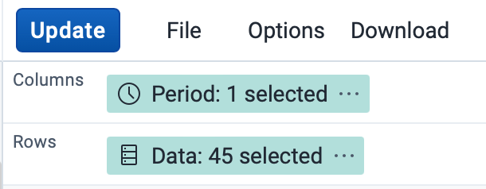

4. Open **Options** and:
   1. Enable **Row totals**.
   2. In the **Advanced** section, change **Aggregation type** to **Count**.
5. Update the visualization, and optionally sort the total column from high to low (the total for expected reports shows NaN, but stays at the top).

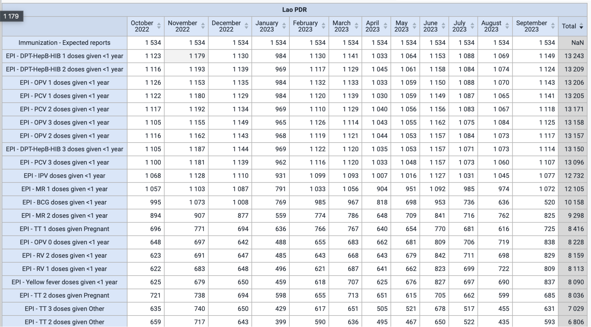

The top row now shows the completeness "denominator" (expected or actual reports), and the other rows show the count of reported values for each data element (with disaggregation). This lets you quickly review the completeness of many data elements at once. With the same approach, a bar chart of a single period sorted from high to low gives a quick visual overview.

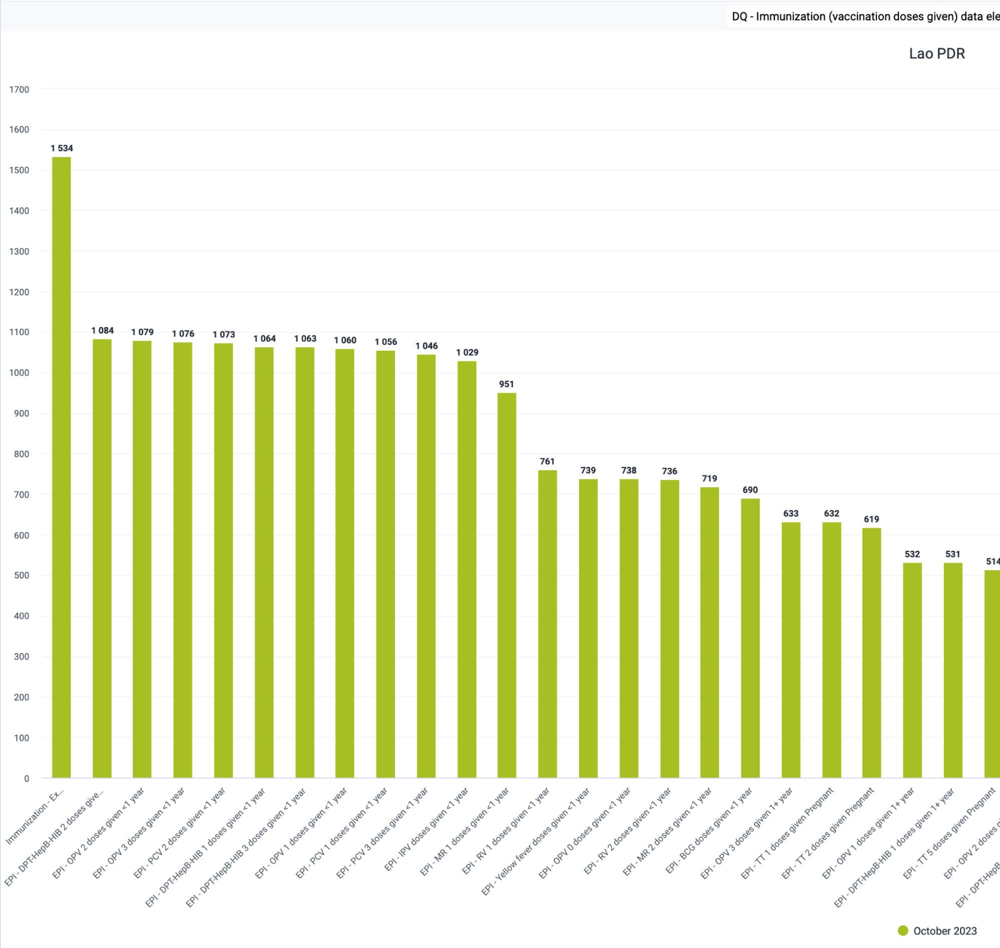

## Consistency of related data

### Scatter plots in Data Visualizer

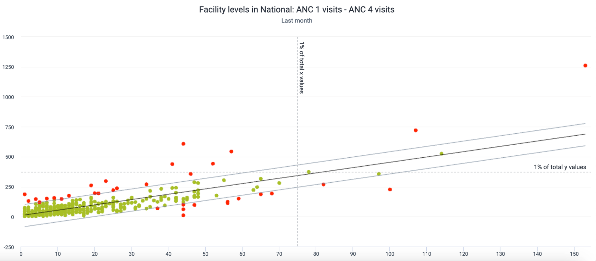

This scatter plot compares two related variables (ANC 1 and ANC 4) across facilities for a period. Because the variables are related, most facilities cluster along a common pattern (green). Facilities that deviate substantially from the expected relationship are highlighted as outliers (red). The further a point is from the outlier lines, the more likely there is an underlying issue with one of the two values.

The outlier detection methods available for scatter plots are:

* Interquartile range (IQR)
* Z-score
* Modified z-score

Z-score is included as a well-understood method, but is the least sensitive of the three.

To create a scatter plot in Data Visualizer:

1. Choose the **Scatter** chart type. The layout is partly locked: points are always organisation units, and you must choose one data item for each of the vertical (Y) and horizontal (X) axes.
2. Choose two *related* data items for the two axes, in this example ANC 1 (Y) and ANC 4 (X). Unrelated data items do not produce a useful output.
3. Choose the organisation units (for example, all facilities) and period, and click **Update**.

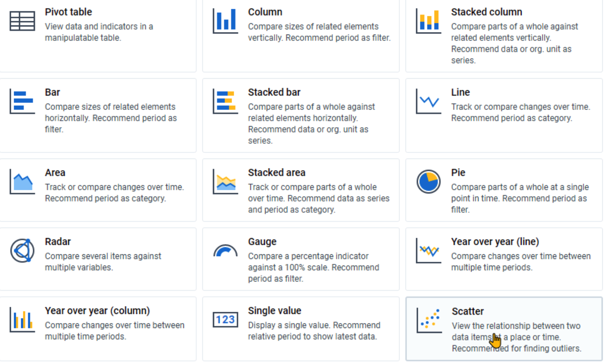

To add outlier detection, open **Options** and go to the **Outliers** tab. Enable **Outlier analysis** and choose the detection method (IQR in this example). Optionally, enable **Extreme lines**, which highlight the most extreme percentiles of the values.

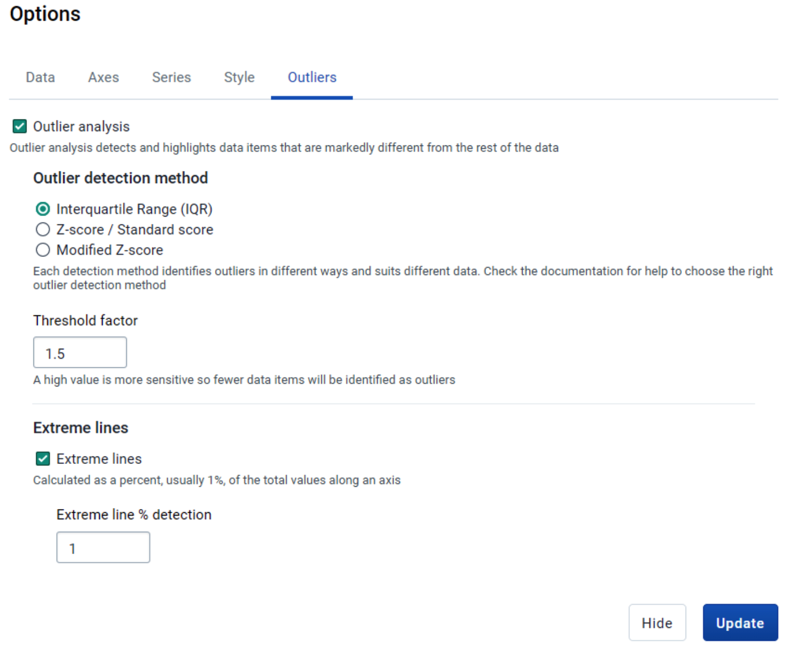

After you update the chart, the outliers are highlighted in red. You can zoom into the cluster by dragging the mouse over the area of interest (**Reset zoom** restores the full view).

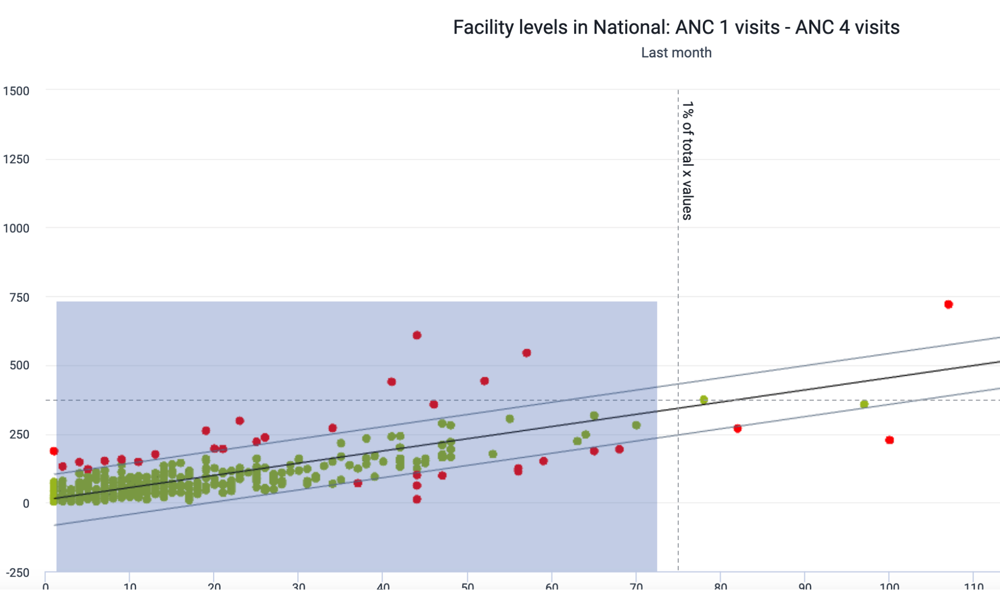

When you interpret the chart, review the relationship between the two variables and compare flagged points to the cluster that falls within the model boundaries:

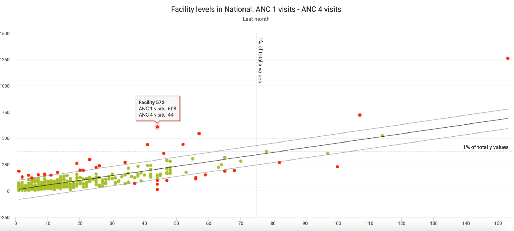

In this example, neither of the two values in the highlighted pairing is extreme on its own (there are higher ANC 1 and higher ANC 4 values elsewhere). However, the *combination* deviates strongly from the pattern of the other facilities: a typical facility with this ANC 4 value has a much lower ANC 1 value. Either value could be incorrect (or the values might be genuinely anomalous), but the deviation is large enough to warrant investigation with the facility.

### Validation rule analysis

Validation rules are integrated into the data entry apps of DHIS2, and you can review them there during data entry as described in the [data entry section](data-quality-02-data-entry.md). You can also review validation rule violations in bulk in the Data Quality app. Rather than checking one organisation unit, period, and data set at a time, you can review violations for many organisation units over any period. Users who do not do data entry can then also analyze and monitor validation rule violations.

When you review validation rules this way, it is best to organize the rules into validation rule groups (see the [data entry section](data-quality-02-data-entry.md)).

To run validation rule analysis, open the **Data Quality** app and click **Run validation** under **Validation Rule Analysis**. Choose your inputs:

* The organisation unit
* Start and end date. These should fully cover the periods you want to review: to review monthly data for June-August 2023, the start date should be 1 July and the end date 1 September (or later).
* The validation rule group containing the rules to review
* **Send Notifications**: whether to send out any configured validation notifications for the violations found
* **Persist new results**

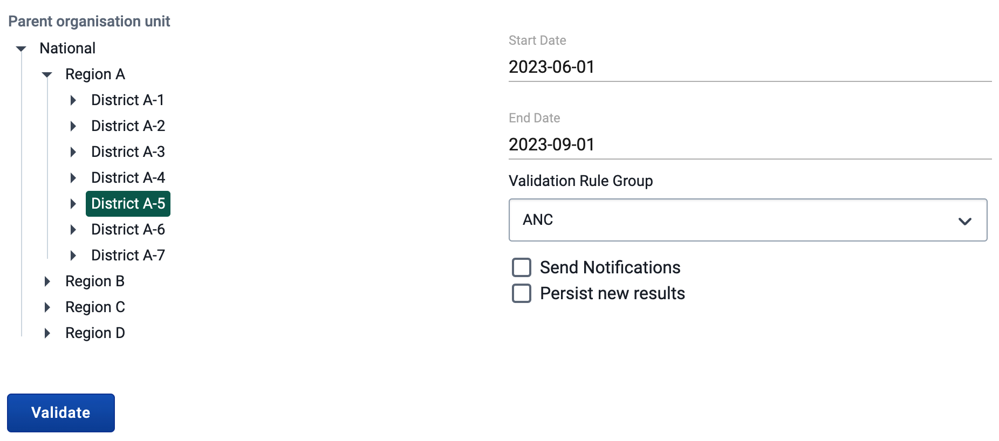

Click **Validate** to run the analysis. Reviewing large amounts of data (many organisation units, periods, and rules) takes longer to run. If there are no violations, DHIS2 shows the message "Validation passed successfully". Otherwise, DHIS2 shows the violations in a list:

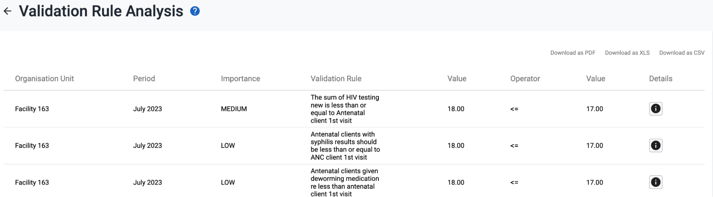

Click the info icon in the **Details** column to see the name and description of the violated rule, together with all the data elements in the rule and their values. This usually lets you identify exactly which value is incorrect and requires follow-up.

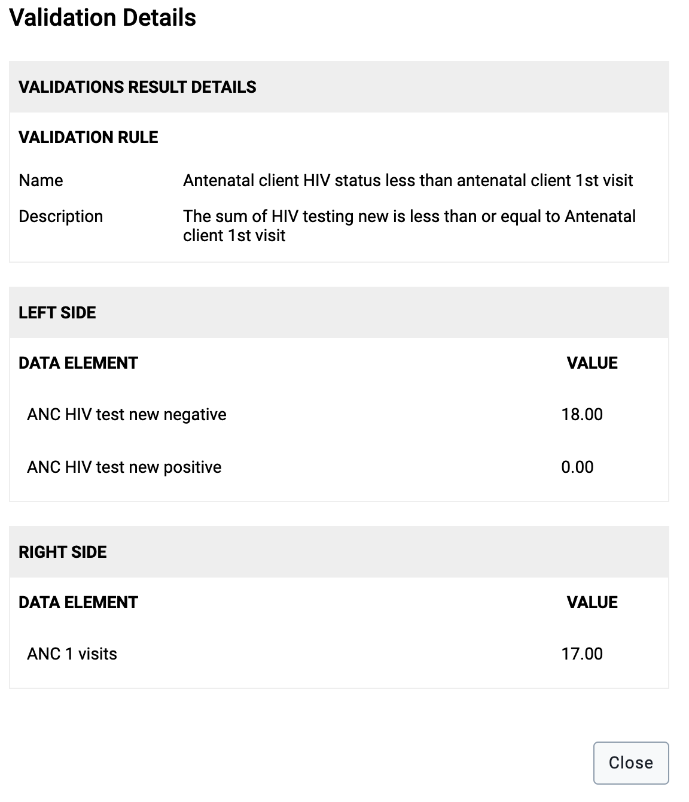

You can also download the violations (file icons in the top right corner) as a reference list for following up on values over time.

Validation rule analysis provides a *snapshot* of the current issues. To monitor validation rule violations over time (how many there are, whether some geographical areas have more than others, and whether the situation is improving), you can use the [Data Quality Workbench](https://github.com/dhis2/tool-dq-workbench). It is a server-side tool that routinely counts violations (and outliers, see [statistical outliers in time series](#statistical-outliers-in-time-series)) by period and organisation unit through the DHIS2 API, and stores the counts in designated data elements. This makes violation trends available for visualizations and data quality dashboards, which is not otherwise possible with validation rules. The tool counts violations per *validation rule group*, and stores the counts against the period of each violation. For this reason, the groups used for monitoring should not mix data elements collected with different period types.

## Consistency over time

### Year-over-year charts

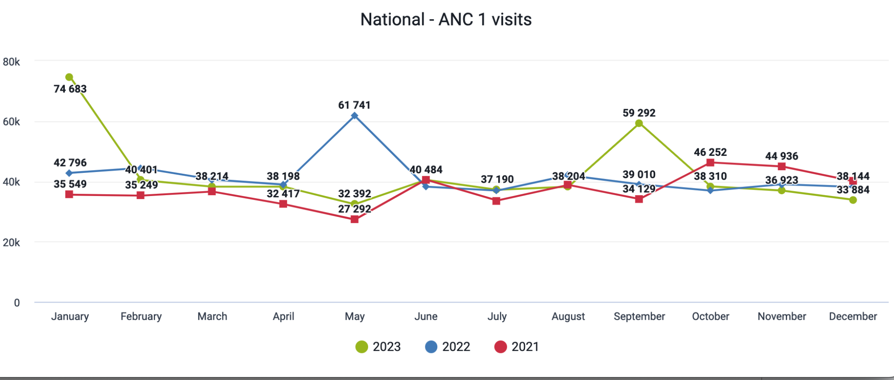

A year-over-year (line) chart is used to evaluate consistency over time of a single data item, plotting each year as a separate line over the months of the year. This helps you spot values that break the historical pattern: in this example, January 2023, May 2022, and September 2023 stand out against the trends of their own and previous years. The next step is to drill down in the hierarchy for these periods to find the source of the discrepancies. Year-over-year charts for key variables are well suited for dashboards reviewed routinely.

To create the chart in Data Visualizer:

1. Choose **Year over year (line)** as the visualization type.
2. The layout is fixed: the *category* and *series* are period selections, and data and organisation units are placed in the filter. Because data is filtered, this chart works best with a single data item selected.
3. The **Category** determines the x-axis periods (for example, **Months per year** for January-December, or **Quarters per year** for quarterly). You can use only relative periods.
4. The **Series** determines which years are shown, either as relative periods (this year, last year) or specific years (for example, 2021, 2022, and 2023).
5. Choose the data item and organisation unit in the filter, and click **Update**.

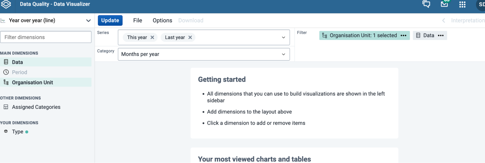

### Statistical outliers in time series

*Extreme outliers* are values that are highly suspicious and need to be double checked for accuracy, because they differ substantially from the values normally reported by a facility. If extreme outliers are found to be actual incorrect values, edit them following local procedures for editing data values. Outliers *in the time dimension* (a facility reporting a value far from its own history) complement the [scatter plots](#scatter-plots-in-data-visualizer), which identify organisation units that are outliers relative to other organisation units in a single period.

DHIS2 offers several complementary ways of working with outliers in time series:

* Configured outlier metrics (indicators and a threshold, described in the following section) that can be placed on dashboards, used in visualizations alongside other data, and combined with other DHIS2 functionality such as validation rule notifications. These require configuration per variable, and are part of the [configured data quality metrics](#configured-data-quality-metrics).
* The outlier table visualization type in Data Visualizer (from DHIS2 2.41), which lists outlier values on a dashboard without any prior configuration.
* Outlier detection in the Data Quality app, for ad-hoc bulk analysis of whole data sets with a choice of statistical methods.
* The [Data Quality Workbench](https://github.com/dhis2/tool-dq-workbench), an external tool that routinely *counts* outliers (and validation rule violations) by period and organisation unit and stores the counts in designated data elements. It counts outliers per data set using a choice of methods (modified z-score, z-score, or min-max violations, plus detection of invalid numeric values). This makes trends in the *number* of outliers available on dashboards for whole data sets. It complements the configured metrics, which give proportions and impact for selected core variables.

The configured outlier metrics flag values *above* the threshold (the typical data entry error for count data), while the outlier table and the Data Quality app flag deviation in either direction.

#### Configured outlier metrics

The configured outlier metrics are based on a stored, per-facility *outlier threshold*: a data element computed monthly by a predictor from the facility's previous reported data (in this guide, we use data from the previous 12 months). Values above the threshold are considered outliers. Two indicators then compare reported values against the threshold at analytics query time:

*Values that are outliers (%)*: of the values that can be assessed, how many are outliers. A metric of data quality that can be used for geographical comparisons or trends over time.

*Excluding outliers (%)*: the sum of non-outlier values as a percentage of all assessable values. A metric of the *significance* of the outliers: how much of the total reported value comes from suspect values. A value of 100% means outliers have no impact on the total.

The threshold data element itself is also directly useful in visualizations, for example to chart a facility's reported values against its threshold, and you can use it in validation rules or notifications.

The following example shows a facility's monthly ANC 1 values, the calculated threshold, and the resulting indicator values:

| | Jan | Feb | Mar | Apr | May | Jun | Jul |
| :-- | :-- | :-- | :-- | :-- | :-- | :-- | :-- |
| ANC 1 | 165 | 196 | 214 | 204 | 219 | 4243 | 195 |
| ANC 1 outlier threshold | 253 | 265 | 253 | 244 | 242 | 246 | 251 |
| Values that are outliers (%) | 0 | 0 | 0 | 0 | 0 | 100 | 0 |
| Excluding outliers (%) | 100 | 100 | 100 | 100 | 100 | 0 | 100 |

At a single facility the indicators are all-or-nothing per month. Aggregated across facilities, they give the proportion of values that are outliers and the proportion of the total value that is unaffected, per district, region, and so on.

##### Choosing the outlier method

Two statistical methods for calculating the threshold are supported (by the configuration tool, and equally when configuring manually):

* Modified Z-score (recommended, default k = 3.5): threshold = median + k × MAD / 0.6745, where MAD is the median absolute deviation over the previous 12 months. Because both the median and the MAD are robust against extreme values, the threshold is barely affected by the very outliers it is trying to detect. This is the method generally recommended for health data, and corresponds to the "modified Z-score" method in the built-in outlier tools.
* Mean + k standard deviations (k typically 2.0-4.0): threshold = mean + k × SD (population standard deviation, matching DHIS2's built-in outlier statistics). Simpler to explain, but sensitive to contamination. In the previous example, when the June outlier of 4243 enters the 12-month window, a mean+3SD threshold for July lands at almost 3,900 (close to the outlier value itself), so any smaller repeat outlier would be masked. The modified-Z threshold stays at ~250.

One caveat with the modified Z-score: a facility whose 12 window values are all *identical* has MAD = 0, so the threshold collapses to the median and any increase is flagged as an outlier. This is inherent to the method (DHIS2's built-in outlier tools share it); for such very flat series, the mean + SD method is the fallback.

##### Configuring the threshold predictor

One data element and one predictor are needed per assessed variable. The data element stores the threshold:

* Name: for example, "DQ - ANC 1st visit outlier threshold (modified-Z 3.5)"
* Domain type: Aggregate; value type: Positive or zero integer
* A description explaining that the value is auto-generated and what it means

The predictor writes to this data element:

1. Set the *output data element* to the threshold data element.
2. Set *period type* to match the data collection frequency (Monthly).
3. Set *organisation unit levels* to the level at which data is collected (typically Facility), and *organisation units providing data* to include the level's descendants (`DESCENDANTS`). At the data collection level this is equivalent to "at selected level(s) only", but unlike that option it also works on DHIS2 2.43 (see the legacy note in the [overview](#configured-data-quality-metrics)).
4. Set the *generator* according to the chosen method:

   For modified Z-score (k = 3.5), use the missing value strategy **Skip if any value is missing**. This strategy is required for a correct MAD calculation when months are missing. With this strategy, months without data are excluded from the median/MAD calculation, so facilities with reporting gaps still get a threshold based on the months they did report:

   ```
   median(#{DE_UID}) + 3.5 * (median(greatest(#{DE_UID} - median(#{DE_UID}), median(#{DE_UID}) - #{DE_UID})) / 0.6745)
   ```

   For mean + SD (k = 3.0), use the missing value strategy **Skip if all values are missing**:

   ```
   avg(#{DE_UID}) + (3.0 * stddevPop(#{DE_UID}))
   ```

5. Set the *sequential sample count* to 12 (the previous 12 months are used to calculate the threshold), and annual sample count and sequential skip count to 0.

The predictor must be [scheduled](data-quality-04-implementation.md) to run, typically nightly, before the analytics job. Threshold values appear in analytics after the first predictor run followed by an analytics run.

##### Configuring the outlier indicators

Both indicators have indicator type Percentage (factor 100) and should not be annualized. With `#{DE}` as the assessed data element and `#{THR}` as the threshold data element:

**Values that are outliers (%)**

```
Numerator:   subExpression(if(isNotNull(#{DE}) && isNotNull(#{THR}), if(#{DE} > #{THR}, 1, 0), 0))
Denominator: subExpression(if(isNotNull(#{DE}) && isNotNull(#{THR}), 1, 0))
```

**Excluding outliers (%)**

```
Numerator:   subExpression(if(isNotNull(#{DE}) && isNotNull(#{THR}), if(#{DE} <= #{THR}, #{DE}, 0), 0))
Denominator: subExpression(if(isNotNull(#{DE}) && isNotNull(#{THR}), #{DE}, 0))
```

The `isNotNull(...) && isNotNull(...)` guards implement the blank-vs-zero rule: a facility-month is *assessable* only if the facility both reported a value and has a threshold (that is, has reporting history). A facility's very first months of reporting, before any threshold exists, are blank rather than being flagged 100% outlier. Facilities that did not report at all are not counted as "non-outliers" in the denominator. These guards are required: inside a subExpression, DHIS2 otherwise substitutes 0 for missing values in comparisons, which would silently produce misleading results. (A facility showing 100% outliers in its very first month of reporting is the tell-tale sign of missing guards: the absent threshold is compared as 0, so any value is "above" it.) As with the consistency indicator, use these indicators in monthly layouts only.

As with the other configured metrics, the Data Quality Configuration Helper Tool generates the threshold data element, predictor, and both indicators (for the data element total or one specific disaggregation), and lets you edit the threshold factor *k* later.

#### DHIS2 outlier analysis

It is not realistic to configure outlier metrics for every data element. With outlier analysis in the Data Quality app, you can analyze whole data sets for outliers without prior configuration. This makes it a useful complement to the configured metrics.

To run outlier analysis, open the **Data Quality** app and click **Analyze** under **Outlier detection**. Start by choosing the key parameters for the analysis:

* **Data set**: one or more data sets to include
* **Organisation units**: all organisation units below the chosen units are included
* **Start date** and **End date**: the periods to analyze for outliers. Data from *all* periods for an organisation unit and data element is included when the average/median and standard deviation are calculated, unless limited under the advanced options.

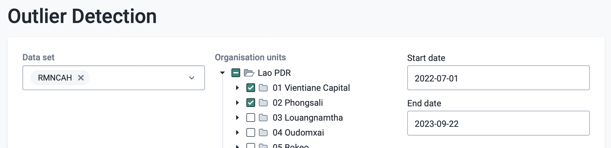

Next, set the statistical method and parameters:

* **Algorithm**:
  * Z-score: outliers based on standard deviations from the mean ([about z-scores](https://en.wikipedia.org/wiki/Standard_score))
  * Modified z-score: outliers based on deviation from the median (more robust, recommended)
  * Min-max: based on stored [min-max values](data-quality-02-data-entry.md)
* **Threshold**: the number of (modified) standard deviations from the mean/median a value must be before it is considered an outlier. The default of 3 is a common definition of an "extreme" outlier.
* **Max results**: the maximum number of outliers included in the results table.

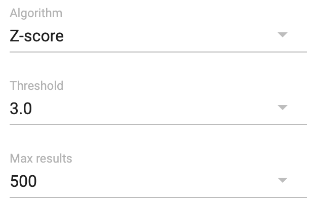

Optionally, change the advanced options:

* Data start and end date: limits what data is used for calculating the mean/median and standard deviations. The statistics need a certain number of periods to be meaningful.
* Sort by:
  * Absolute deviation from median/mean (default): the outliers with the biggest impact on the aggregated result are shown first.
  * Z-score / modified z-score: "how extreme" the outlier is. A small value from a small facility can rank above a much larger value from a big facility if it is further from its own mean/median.

Click **Start** to run the analysis. The resulting table lists the detected outliers with the data element, period, organisation unit, value, z-score, deviation, standard deviation, median/mean, and min/max. Use the **Follow-up** checkbox to mark values for follow-up. You can then list them later with the **Follow-up analysis** function of the Data Quality app.

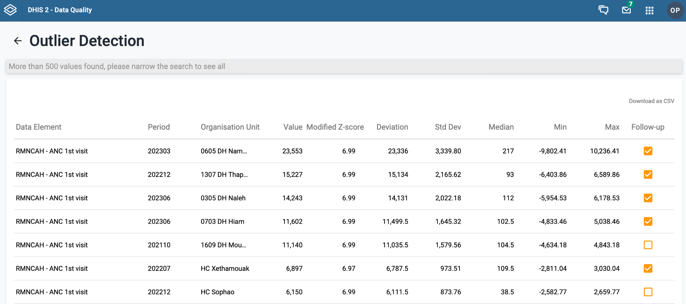

#### Outlier tables

The outlier table is a visualization type available from DHIS2 2.41. It is partly meant to replicate and expand on the outlier table functionality that was previously available in the WHO Data Quality Tool. It analyzes the selected data for outliers at query time, without any configuration, and you can save it on dashboards like any other visualization. 

> Note: this feature requires the "outlier data" analytics process to be run, which is currently disabled by default as it can almost double aggregate analytics processing times. 

To create an outlier table in Data Visualizer:

1. Choose the outlier table visualization type.
2. Choose inputs for the three fixed (and required) dimensions: Data, Period, and Organisation units. You can choose multiple data items.
3. Click **Update**.

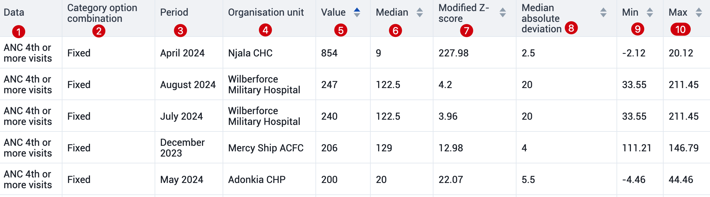

The columns of the table:

1. Data: the data item
2. Category option combination: the specific disaggregation, if any, that the outlier value belongs to
3. Period: the period of the outlier value
4. Organisation unit: the *source* organisation unit of the value (if you choose an organisation unit in the hierarchy, the table looks for outliers in all its children)
5. Value: the value recorded in DHIS2
6. Median: the middle value for the data element, category option combination, and organisation unit combination
7. Modified z-score: a standardized measure of outlier strength, that is, how much the value differs from the typical (median) value
8. Median absolute deviation: the average distance of values from the median, describing how spread out the series is
9. Min / Max: the stored min-max thresholds for the combination, where set

Under the table options, you can adjust the maximum number of results (up to 500) and the display style. In the **Outliers** tab, you can adjust the detection method and threshold factor. By default, the table uses the *modified z-score* with a threshold factor of 3. The z-score (standard score) method uses the mean rather than the median and is less robust.

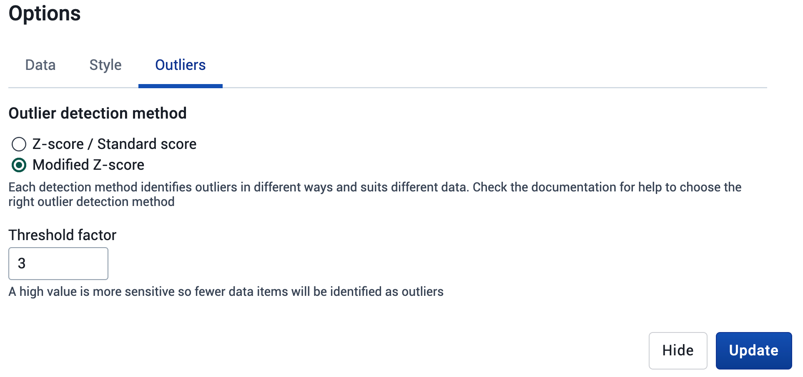

## WHO Data Quality Tool

The WHO Data Quality Tool is an application that has been available in the [DHIS2 App Hub](https://apps.dhis2.org/) since around 2016, supporting a range of data quality analysis based on the WHO Data Quality Review framework. At the time of its release, most of this functionality was not available in core DHIS2 applications. That is no longer the case, and the WHO Data Quality Tool is not being updated for new DHIS2 versions. It should not be part of new DHIS2 implementations, and existing implementations should plan to transition to the equivalent core functionality:

* Completeness, timeliness, and data element completeness: core visualization apps and the [configured data quality metrics](#configured-data-quality-metrics)
* Outlier analysis: the outlier table visualization, the Data Quality app, and the configured outlier metrics
* Consistency of related data (scatter plots, dropout rates): Data Visualizer
* Year-over-year comparisons: Data Visualizer
* Automatic generation of annual data quality reports: the [Data Quality Annual Report app](https://apps.dhis2.org/app/73f87a14-d71c-40b8-8363-0d956745ba06), which fills the remaining functionality gap

For implementations still using the tool, the [WHO Data Quality Tool user manual](https://docs.dhis2.org/en/use/optional-apps/who-data-quality-tool/installation-and-configuration.html) remains available.
