# Implementing data quality functionality and procedures

As outlined in the sections on data quality features related to [data entry](data-quality-02-data-entry.md) and [analysis](data-quality-03-analysis.md), DHIS2 has a wide range of functionality for ensuring data quality. However, the existence of functionality does not automatically lead to it being used. This section discusses approaches to increase uptake of this functionality. It covers four topics related to this:

1. [Automating data quality analysis through dashboards and validation notifications](#automated-data-quality-analysis)
2. ["Minimum requirements" for implementation of data quality functionality in DHIS2](#minimum-standards-for-data-quality)
3. [Standard operating procedures (SOPs) on data quality for use at different levels of the health system](#sop-for-data-quality)
4. [Key maintenance operations](#key-maintenance-operations) that the data quality functionality depends on: scheduling, and email/SMS notification settings

## Automated data quality analysis

To encourage users to review data quality on a routine basis, data quality functionality must be easily available and "pushed" to users as much as possible. DHIS2 has two main ways of doing this:

-   Configuring and sharing dashboards with users that provide ready-made data quality analytics.
-   Using the validation rule notifications functionality to notify users of severe validation rule notifications.

### Data quality dashboards

Dashboards with data quality metrics are the main way to provide automated data quality analysis to users. As discussed in the section on [minimum standards](3minimum-standards-for-data-quality), different groups of users should each have access to automated data quality analysis through dashboards designed specifically for their needs. When you plan and design dashboards for different user groups, consider the issues in the following sections.

Two limitations apply to what can be put on data quality dashboards through DHIS2 configuration alone: the more in-depth metrics must be configured per variable (and are thus limited to core variables), and validation rule violations cannot be visualized at all. The [Data Quality Workbench](https://github.com/dhis2/tool-dq-workbench) fills these gaps by routinely counting outliers and validation rule violations by period and organisation unit and storing the counts as data values. You can then include these values in dashboards like any other data (see the [analysis section](data-quality-03-analysis.md)). The same tool can also record the results of DHIS2's metadata integrity checks over time (see the *Metadata integrity and quality* section of this guide).

#### Selecting core indicators

The more in-depth data quality metrics in DHIS2 require additional metadata for every core variable that you want to assess. The amount of metadata per variable is modest (four indicators, one predictor, and one data element; see the [configured data quality metrics](data-quality-03-analysis.md)), and the [DQ Metrics Configuration Tool](data-quality-03-analysis.md) automates its creation. Nonetheless, each assessed variable adds objects that must be maintained, and dashboards built on the metrics must be kept reviewable. Such metrics should therefore be configured for a deliberately selected set of core indicators. The [WHO DQA toolkit](https://www.who.int/data/data-collection-tools/health-service-data/data-quality-assurance-dqa) provides a list of core indicators for certain health programs. Together with the core indicators defined in national M&E plans, this list is a good starting point for which variables to prioritize. This also means that dashboards can give an overview of data quality issues and more in-depth information for certain key variables, but users must still be [trained](#minimum-standards-for-data-quality) in how to use other data quality functionality. There should also be [SOPs](#sop-for-data-quality) outlining what data quality-related activities they should perform routinely.

#### Operational or analytical focus

The second element to consider is to what extent the automated dashboards should be designed to be operational or analytical tools, or a combination. At the district and facility level, where users are directly responsible for entering accurate data in a timely fashion, dashboards can be designed to be more operational. For example, highlighting specific data values flagged as potential outliers, or individual facilities that have not yet reported for the current period. For analysts at national level, needs are more likely to be around assessing whether the data is of an acceptable quality to make informed decisions based on it. So seeing individual outlier values is less relevant, but a measure of what proportion of the reported data values are potential outliers is relevant for the analysis. Analytics can also have an operational focus at higher levels, such as being able to monitor trends or make geographical comparisons of data quality issues so that interventions can be made.

#### Customizing for groups of users

Dashboards should be tailored to and shared with groups of users with similar information needs and roles in relation to data quality. Technically, you can give all users access to a large number of dashboards by using the [sharing](https://docs.dhis2.org/en/use/user-guides/dhis-core-version-master/configuring-the-system/about-sharing-of-objects.html?h=sharing+master+use) functionality to make them *public* (to all users). However, even if a set of public dashboards covers all key aspects of data quality, users are less likely to find and review the information in a set of dashboards if only a small subset of this information is relevant to them. Key groups of users should therefore be identified for which tailored, automated analytics can be developed in the form of dashboards.

Two dimensions are key in defining these groups of users: the level of the health system at which users are based (national, district, facility, and so on), and the health area(s) for which they work. The two are closely related, because users at higher levels are typically more specialized in terms of health area or program, while users at lower levels have broader responsibilities. For example, in a small facility, one or two people might be responsible for data and reporting for all health services. In the district, there could be people responsible for the cross-cutting HMIS reporting as well as more specialized focal points for specific programs. At national level, each health program might have a team of data analysts.

When considering what user groups to target in terms of DHIS2 data quality dashboard requirements, keep in mind that individual users can be part of multiple groups of users, both in their actual work and technically in terms of user groups in DHIS2. For example, if two data quality dashboards have been developed specifically for monitoring malaria data quality and to provide key data quality metrics for districts, users working in a district that are also responsible for malaria should have access to both dashboards (that is, be part of both "district users" and "malaria programme users" groups). Assuming *relative* organisation units and [*relative* periods](https://docs.dhis2.org/en/use/user-guides/dhis-core-version-master/understanding-the-data-model/about-data-dimensions.html?h=relative+master+use#relative-periods) are used according to best practice for visualization and dashboard design, the same dashboards can often be re-used both at national and sub-national level. The exception is at the facility level, because any analysis involving comparisons across multiple organisation units will not work well for facility users.

#### Data quality dashboard examples

As references to how DHIS2 data quality functionality can be implemented, example data quality dashboards are available in the integrated HMIS demo database environment maintained by the HISP Centre. \[PLACEHOLDER: link to demo instance with updated DQ configuration\] These dashboards generally follow the data quality principles outlined in the [data quality principles](data-quality-01-principles.md) section and the [WHO DQA framework](https://www.who.int/data/data-collection-tools/health-service-data/data-quality-assurance-dqa). However, because the focus is on *routine* (monthly) monitoring, they do not include the data quality checks around denominator consistency and external consistency (for example with household surveys). These change at most annually under normal circumstances. The configured data quality metrics must be used in monthly layouts (see the [analysis section](data-quality-03-analysis.md)).

Apart from external consistency checks, the dashboard examples provide metrics on each of the key data quality dimensions:

-   completeness and timeliness of data, at the data set and data element level

-   consistency between related data

-   consistency over time (outlier detection)

Four indicators are used in the example dashboards, based on the core indicators recommended in the [WHO DQA framework](https://www.who.int/data/data-collection-tools/health-service-data/data-quality-assurance-dqa) (the fifth core indicator, TB notifications, is not included in the initial version of the dashboards because of limitations of the data available in the HMIS demo database).

##### National to district level

The dashboard **DQ - Data Quality Core** is available in the HMIS demo database. \[PLACEHOLDER: link and login details for updated demo instance\]

The dashboard is best reviewed by logging in to DHIS2. This section gives a summary of its key components.

**Completeness**

*Line charts* showing the 12-month trend for the core indicators:

-   Reporting completeness (per data set)

-   Facilities reporting consistently the previous 12 months

*Single value charts* for each core indicator, for the last month:

-   Data element completeness

-   Facilities reporting consistently the previous 12 months

*Tables* with key completeness/timeliness metrics for the last month, comparing organisation units (at the user's level and below). One table is included for each core indicator. The tables use a customized legend set to color cells according to completeness.

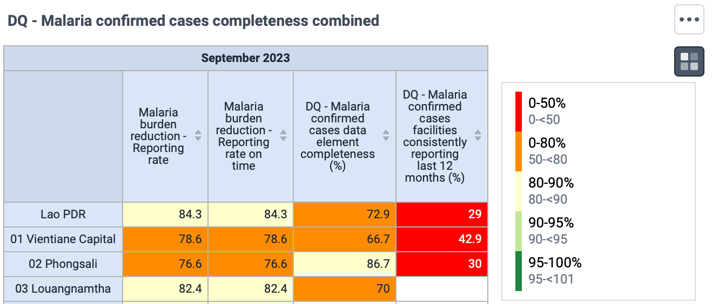{ .center width=75% }

**Consistency of related data**

*Scatterplots* showing the core variables against a related variable, across multiple organisation units (one level below the user). Outlier detection is enabled and highlights organisation units flagged by the modified z-score method with a threshold of 3.

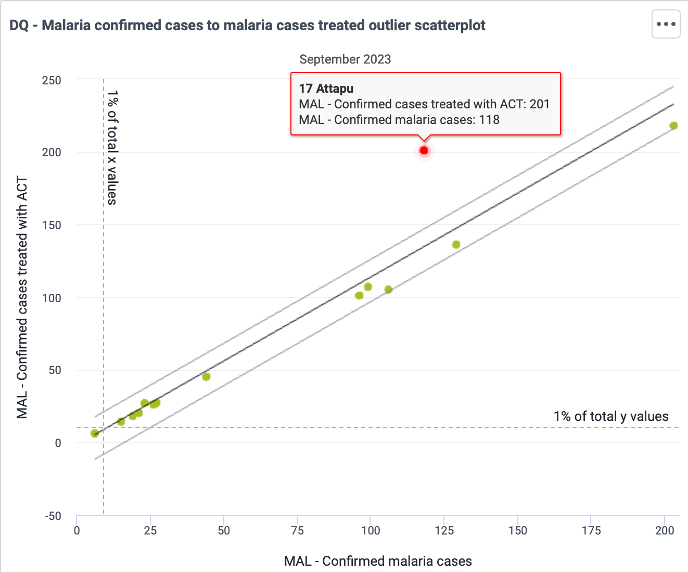{ .center width=65% }

*Dropout rates* (for variables where applicable) over the last 12 months, presented with a column chart sorted from low to high with negative values highlighted and a corresponding table listing the organisation units with negative values.

**Consistency over time**

*Year-over-year charts* for each variable, showing the monthly values for the current year and the preceding 5 years.

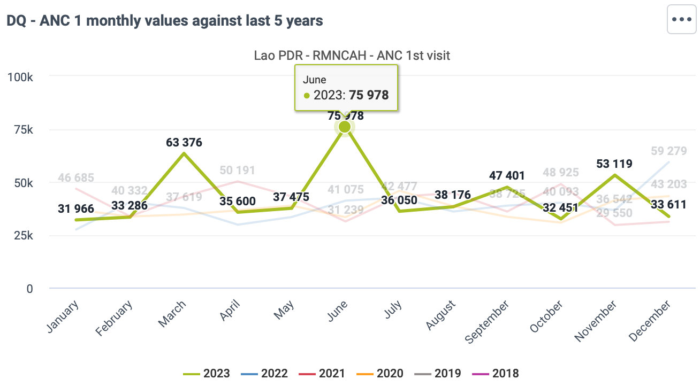{ .center width=65% }

*Value excluding outliers* for each of the four variables:

-   Single value charts for the last month

-   Table with values for the last 12 months, with legend set applied

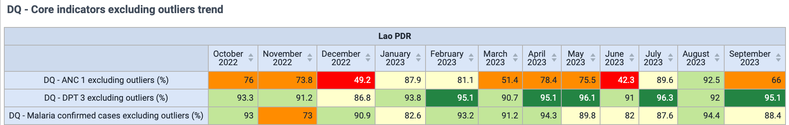

*Outlier tables* listing the largest outlier values for each of the variables in the last 3 months, for organisation units below the user's level.

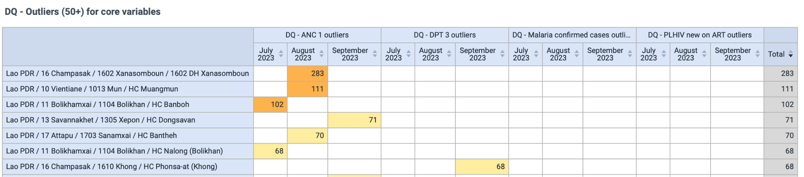

##### Facility level

A facility-level version of the **DQ - Data Quality Core** dashboard is also available in the HMIS demo database. \[PLACEHOLDER: link and login details for updated demo instance\]

The dashboard is best reviewed by logging in to DHIS2. This section gives a summary of its key components.

**Completeness**

*Tables* with key completeness/timeliness metrics for the last 12 months (one table for each core indicator), showing:

-   Data set expected reports: 1 if the facility is supposed to report, 0 otherwise

-   Data set actual reports: 1 if the facility has marked the data set as complete, 0 otherwise

-   Data set actual reports on time: 1 if the facility has marked the data set as complete before the reporting deadline, 0 otherwise

-   Variable value (for example ANC 1st visits): the actual data value, to directly assess the data element completeness

The tables use a customized legend set to highlight values of 0, but in a neutral color, because some facilities are not expected to report on all key variables.

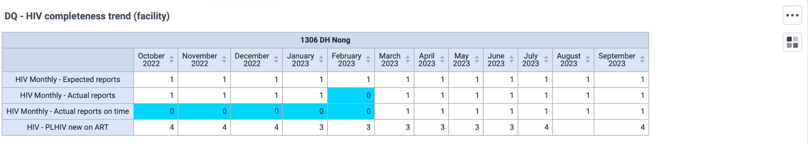

**Consistency of related data**

*Dropout rates* (for variables where applicable) over the last 12 months, presented as a single column chart with negative values highlighted and a corresponding table listing the organisation units with negative values.

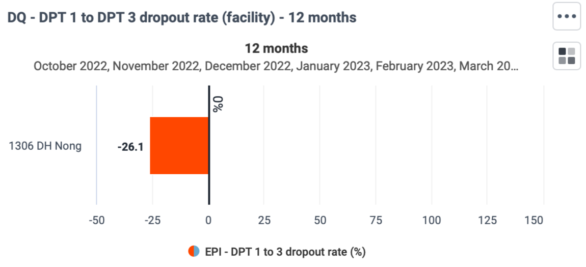{ .center width=55% }

**Consistency over time**

*Year-over-year charts* for each variable, showing the monthly values for the current year and the preceding 5 years.

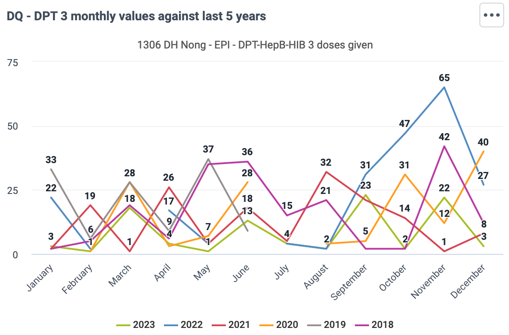{ .center width=55% }

*Outlier tables* listing the largest outlier values for each of the variables in the last 12 months, for the user's organisation unit.

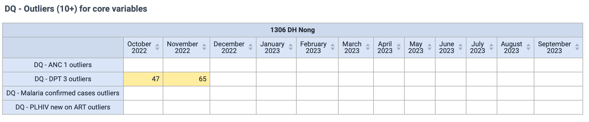

*Charts comparing reported values with the calculated outlier threshold* for each of the variables in the last 12 months for the user's organisation unit.

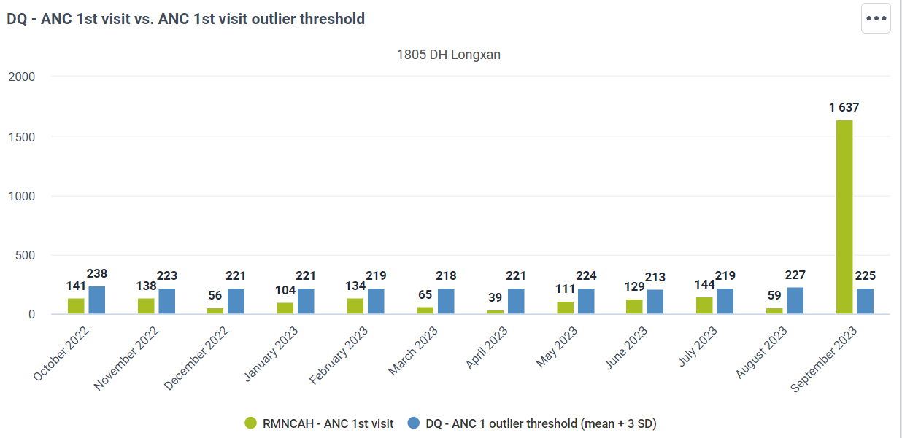{ .center width=80% }

#### Dashboards from WHO toolkits

As part of the health data toolkits, data quality dashboards are being included for specific health programs. These are valuable resources that should be reviewed when implementing data quality dashboards for each respective area. For example, the [Malaria data quality dashboard](https://docs.dhis2.org/en/topics/metadata/malaria/malaria-hmis/design.html#malaria-data-quality-dashboard) has been published and is available in the HMIS demo database, and data quality dashboards for other health programs are being added to the respective toolkits over time.

### Validation rule notifications

Dashboards are the main way of providing automated data quality analysis to users. However, validation rule notifications can also be used for this purpose, and can be a useful complement if configured correctly. Depending on how DHIS2 is configured, you can configure validation rule notifications so that users receive messages within DHIS2, by email, or by SMS if a certain logical test is true. For data quality, this means that a value is above a certain threshold so that it is flagged as a potential outlier.

Implementation of this functionality needs to be managed carefully, because sending too many messages can make people stop paying attention. This is particularly true if notifications:

-   are sent to people for whom the message is not relevant (that is, they have no responsibility for checking/correcting the potential error)

-   include too many false positives (that is, values that turn out not to be data quality errors)

-   are not significant enough to warrant sending out a dedicated message

Validation rule notifications should therefore be used with caution for data quality monitoring, and are best suited for very high priority variables for which there have been consistent problems with data quality.

### Reference: data quality metrics

The data quality metrics and analytics that can be provided as automated analysis through dashboards or push notifications are described in detail in the [analysis section](data-quality-03-analysis.md). In summary, for a single variable: data set completeness and timeliness, data element completeness, facilities consistently reporting, scatterplots and dropout rates against related variables, year-over-year charts, outlier tables, the configured outlier metrics (values that are outliers (%), excluding outliers (%), and the outlier threshold itself), counts of outliers and validation rule violations over time (using the Data Quality Workbench), and notifications (DHIS2 message, email or SMS) if values are over the outlier threshold.

## Minimum standards for data quality

DHIS2 has a wide range of functionality for ensuring and assessing data quality. However, much of this requires configuration by the national DHIS2 core team, and it must be made available for end users. Beyond the DHIS2 configuration, the training provided to end users of DHIS2 must include data quality functionality. There must also be SOPs for staff at all levels that clearly state their role in ensuring that data is of good quality. This section outlines what the HISP Centre considers a minimum of configuration and implementation standards for ensuring data quality.

### Data entry configuration

-   Validation rules configured for all data sets currently in use, covering all data elements where logical comparisons can be defined according to validation rule best practices.

    -   Health data toolkits provide a reference with recommended validation rules for several health programs.

-   Data sets that have been used routinely for at least one year with reasonable reporting completeness should be considered for generation of min-max values.

    -   Methods other than the built-in **min-max value generation** feature should be used.

### Dashboards and indicators

-   Data quality indicators should be configured for (at least) high-priority MoH/health program indicators, using the [DQ Metrics Configuration Tool](data-quality-03-analysis.md) or manual configuration:

    -   Data element completeness

    -   Facilities consistently reporting

    -   Values that are outliers / data excluding outliers

-   Data quality dashboards should be developed and made available to all users, according to their data quality analysis needs

    -   Data quality dashboards from health data toolkits should be reviewed as reference

### User roles and access

-   Users should have access to the core **Data quality** app, and other data quality apps that are installed or configured (for example the Data Quality Annual Report app). This includes:

    -   All users responsible for entering and validating data

    -   All users with data analysis access, unless when there are clear arguments otherwise

### Other configuration

-   [Data Quality Annual Report app](https://apps.dhis2.org/app/73f87a14-d71c-40b8-8363-0d956745ba06) installed and configured to support annual data quality reviews

-   Validation rule notification considered (implementing this is *not* considered part of a minimum data quality standard, but should be considered on a case-by-case basis)

    -   Notification options (email and/or SMS) configured if using validation rule notifications

### Training and job aids

-   Training curriculum and material for staff using DHIS2 should cover use of data quality functionality

-   Job aids, user manuals and other resources available to users should cover data quality functionality

### Standard operating procedures

-   SOPs for data quality should be defined and available to users

    -   This could be a dedicated SOP for data quality, or data quality could be embedded in SOPs for data collection and/or data analysis

## SOP for data quality

SOPs covering data quality should be available for users working with data at all levels of the health systems. The SOPs should outline *who* would do *what*, *when*, and *how* it should be done. This means that the key roles related to data quality must be defined, and the responsibilities of each role. Examples of data quality-related activities that should be described include:

-   What actions should be taken if validation rule or min/max violations occur during data entry?

-   When should data be reported by, and when should it be reviewed by?

-   What are the steps that should be taken by different levels of the health system to review the data?

-   What should be done when an incorrect value or outlier is identified at different levels?

Data quality SOPs have to be developed according to the context and established procedures in each implementation. However, you can use [this data quality SOP template](https://docs.google.com/document/d/1w9bhvCEgewrKLSNsizfpPBoAv2WCd3aM9wzbt3x4yHE/edit?usp=sharing) as a starting point for a country-specific version.

## Key maintenance operations

For the data quality functionality described here to work as intended, certain underlying functionality must also be configured.

### Scheduling

Of the [configured data quality metrics](data-quality-03-analysis.md), only the outlier metrics rely on a predictor (calculating the outlier threshold); the completeness and consistency indicators are computed directly by analytics and need no additional scheduling. Two scheduled jobs are therefore involved:

1. A *predictor* job covering the outlier threshold predictors (or the predictor group they belong to; the DQ Metrics Configuration Tool maintains such a group). The threshold predictors are independent of each other, so there are no ordering constraints between them.
2. The *analytics tables update* job, which must run *after* the predictor job for newly predicted thresholds to become visible in analytics (and for the indicator values that depend on them to update).

You schedule predictors in the [Scheduler app](https://docs.dhis2.org/en/use/user-guides/dhis-core-version-master/maintaining-the-system/scheduling.html#scheduling). To make sure that the analytics job starts only after the predictor job is finished, put both jobs in a *job queue*. A job queue runs its jobs in a fixed order: it starts the first job at the scheduled time, and starts each of the next jobs when the previous one is finished. A typical queue runs at night and contains the predictor job first and the analytics table job after it, so that the thresholds for the new month are in place in analytics the next morning. To create a queue, click **New queue** in the Scheduler app, and add the jobs to **Jobs in this queue** in the order they must run.

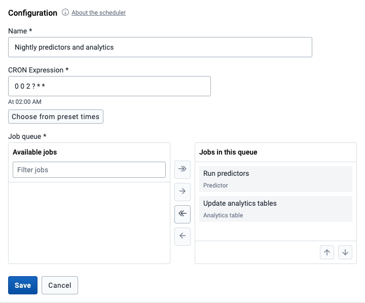{ .center width=65% }

If you use validation rule notifications, add the *monitoring* job that evaluates validation rules to the end of the queue.

The analytics table job also has an outlier step. By default, after it updates the aggregate analytics tables, the job also generates the outlier data that the [outlier tables](data-quality-03-analysis.md#outlier-tables) in Data Visualizer use. (Outlier detection in the Data Quality app reads the raw data values and does not depend on this step.) On large databases, this step can take roughly as long as the update of the aggregate analytics tables. Include it in the nightly job only when the aggregate analytics update is fast enough that the job still finishes before users start work. Otherwise, skip outliers in the nightly job (with the **Skip outliers** parameter of the analytics table job) and run a separate analytics job with outliers less often, for example once a week.

Test the jobs on a development server with a copy of the production database, to learn how long each job takes, and schedule them accordingly.

If the [Data Quality Workbench](https://github.com/dhis2/tool-dq-workbench) is used for monitoring, it is scheduled *outside* DHIS2 (typically as a nightly cron job on the server where it is installed, running its `dq-monitor` command). Like the predictor job, its output consists of data values that only become visible in analytics after the next analytics table update, so its runs should also be timed to finish before the analytics job.

> **Note**
>
> Legacy predictor-based configurations (see the [analysis section](data-quality-03-analysis.md)) additionally require the comparison predictors to run *after* the threshold predictors, that is, an ordered chain of predictor jobs. If such configurations are still in use, put all the jobs in one job queue: the threshold predictor job first, the remaining predictor jobs after it, and the analytics job last.

### Email and SMS notifications settings

By default, DHIS2 sends all messages as internal DHIS2 messages, whether they are direct messages sent by users, validation notifications, or system notifications. To also forward these messages by email or SMS, DHIS2 must be configured for this, and each user must enable email or SMS notifications.

#### Email configuration

For DHIS2 to send email notifications, you must configure an SMTP server in the [system settings](https://docs.dhis2.org/en/use/user-guides/dhis-core-version-master/configuring-the-system/system-settings.html#system_email_settings). Any mail provider offering an SMTP service can in principle be used for this. The [tutorial on setting up email on a server](https://docs.dhis2.org/en/topics/tutorials/setting-up-email.html?h=smtp+tutorials#setting-up-email-on-a-server) explains how to configure an email service on the DHIS2 host server.

#### SMS configuration

For DHIS2 to send (and receive) SMS messages, you must configure an [SMS gateway](https://en.wikipedia.org/wiki/SMS_gateway). The guide on [using gateways for SMS reporting](https://docs.dhis2.org/en/manage/performing-system-administration/dhis-core-version-master/using-gateways-for-sms-reporting.html#sms_report_android_gateway) discusses alternative options for SMS gateways for DHIS2. [Using an Android device as a gateway](https://docs.dhis2.org/en/manage/performing-system-administration/dhis-core-version-master/using-gateways-for-sms-reporting.html#sms_report_android_gateway) is technically possible, but only recommended for testing and small-scale pilots. [Dedicated SMS gateways](https://docs.dhis2.org/en/use/user-guides/dhis-core-version-master/maintaining-the-system/configure-sms.html#sms-configuration-gateways) are typically offered by commercial providers or mobile operators (for a fee), and these service providers give you the parameters needed to configure the gateway.

#### Enabling and disabling notifications

Each user chooses whether to forward DHIS2 messages to SMS or email (if these have been configured as described in the previous sections). To do this, open **User settings** from the DHIS2 menu bar, and turn each option for SMS and email on or off. Set an option to **Yes** to enable it.

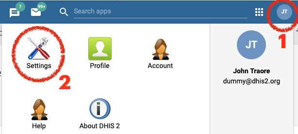{ .center width=55% }

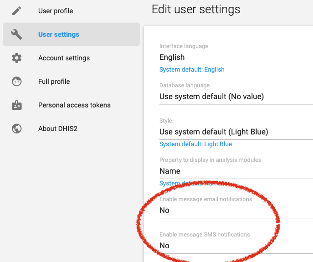{ .center width=50% }