# User guide to the Supervision App for Android

## Background

The Supervision App is designed for field users to manage and monitor supervision activities. It lets you synchronize with DHIS2, and it supports offline use.

The main features are:

* A dashboard showing the current status of indicators.
* An overview of previous supervision action plans.
* Access to supervision tracker forms.  
* Synchronization for sending collected data to DHIS2. 
* Offline functioning.

## Technical specification and installation

### Android requirements

* Works on Android 13 and later
* Compatible with phones and tablets

### Installation instructions

Until the app is published on the Play Store, you can install it manually.

1. Download the APK from your DHIS2 administrator, or get the download link from your DHIS2 administrator: [Android Supervision App](https://github.com/HISPWCA/Supervision-Apks/releases/tag/v.1.2.5).
2. Locate the file in your Downloads folder.
3. Tap the file and follow the on‑screen instructions to install or update the app.

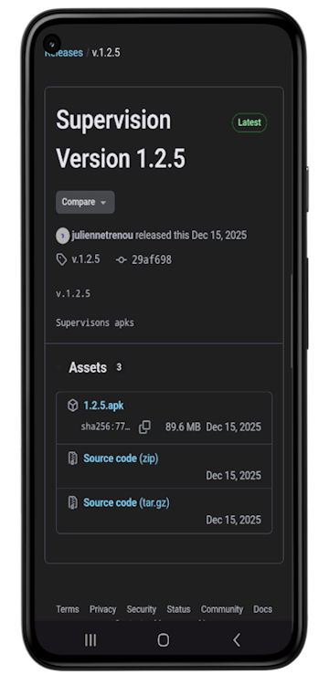

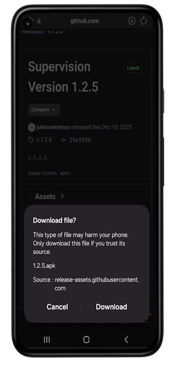

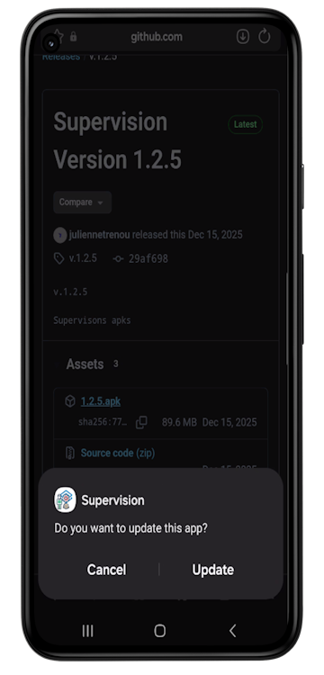

## Login page

1. Open the app.
2. Enter the **Server url**, **Username**, and **Password**.
3. Tap **Log in** to open the home interface.

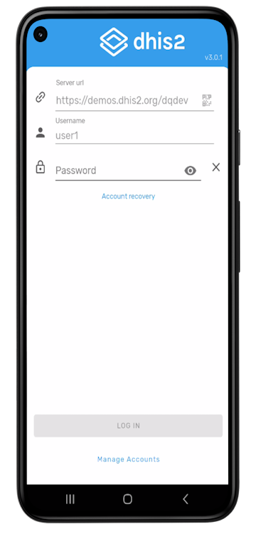

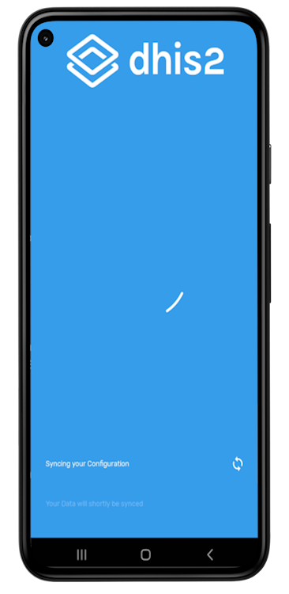

## Home interface

After you log in, the app shows the available supervision forms, for example DQR-RSC.

First-time setup:

1. Tap the menu icon (three horizontal lines).
2. Tap **Settings**.
3. Tap **Sync configuration**.

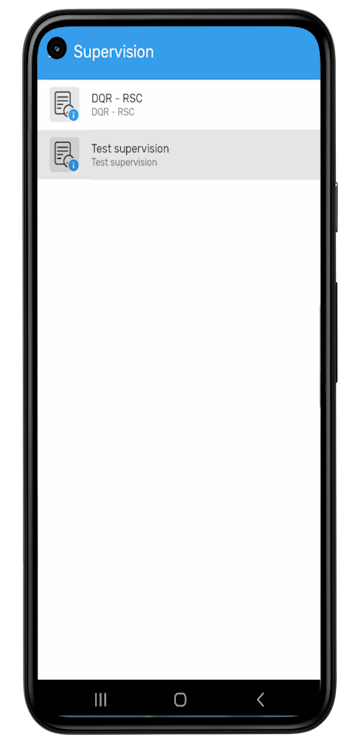

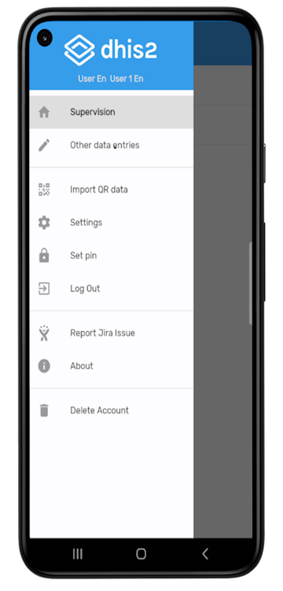

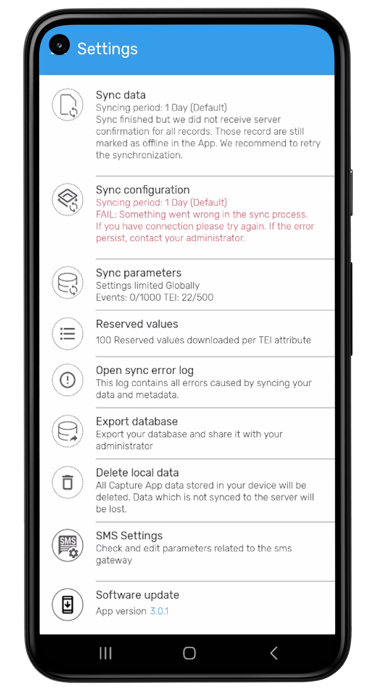

## Selecting a supervision event

1. Choose the tracker program, for example DQR-RSC.

2. Choose the organisation unit to supervise.

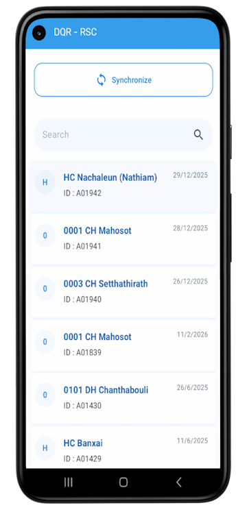

3. View the planned supervisions (events). The most recent appear at the top.

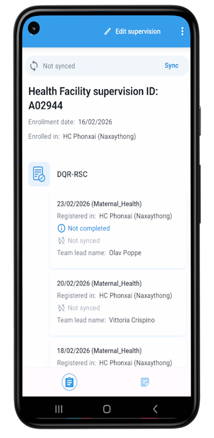

1. Tap an event to show the charts of the indicators whose quality you want to check. The single values at the top are the values for the period shown at the top.
2. To show the values for another period, tap the period and choose the new period in the calendar.

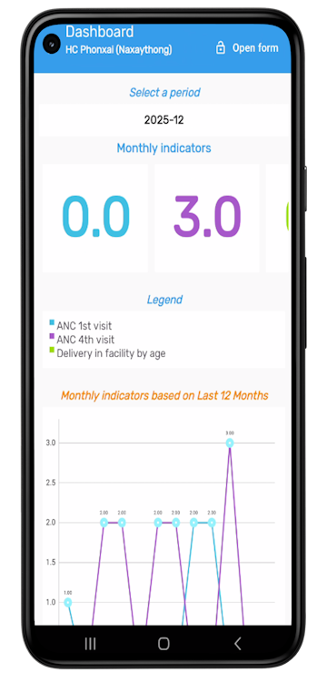

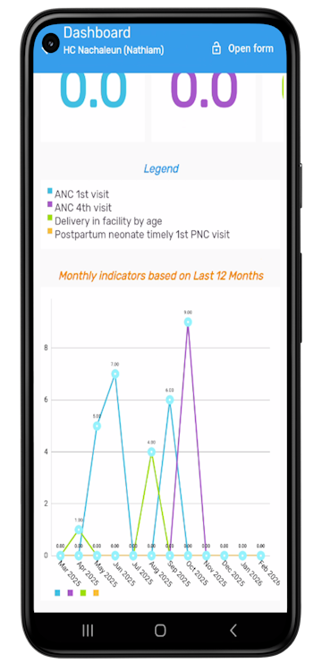

## Open the form

1. Tap **Open form** (top right).
2. Sections are collapsed by default. Tap **Show Fields** to expand.
3. Fill in the required fields section by section.
4. When you have finished, tap **Save** (disk icon, bottom right).

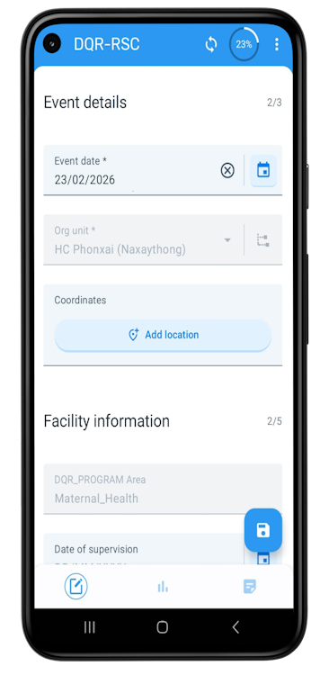

## Supervision dashboard: results visualization

You can view supervision results directly on the Android device, even if the data is not synchronized.

1. Tap the chart icon at the bottom center.
2. To show other indicators, tap the other tabs of the dashboard.

   > **Note**
   >
   > The app generates the dashboard automatically from the data entered, even if there is no Internet connection.

3. You can share the dashboard as a PDF file, online or offline. When online, you can share the PDF file with any communication app on the Android device, for example WhatsApp, Snapchat, Gmail, or Slack. When no Internet connection is available, you can share the file using Bluetooth.
4. To share using Bluetooth, make sure that Bluetooth is enabled on both devices and that they are paired. You can also download the file to your device: tap **Share** > **Printer** > **pdf**.

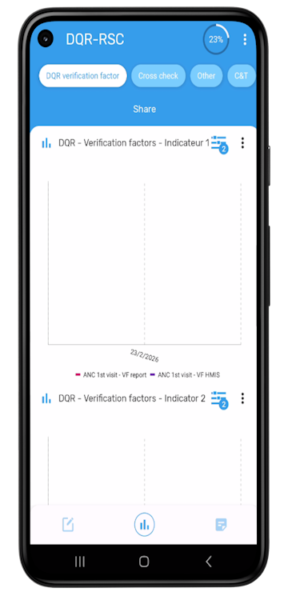

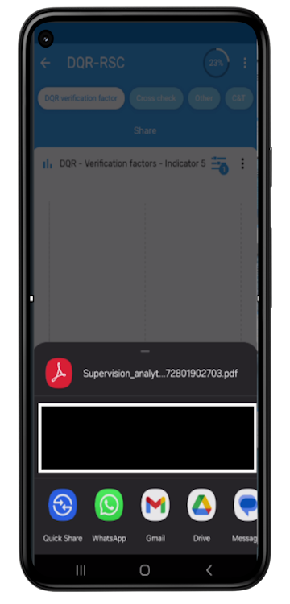

## Data synchronization

After you save supervision data:

1. When back online, go to the supervision selection page and tap **Synchronize**.
2. Alternatively, go to **Settings** > **Synchronize Data** to upload locally saved supervision data to the DHIS2 server.
